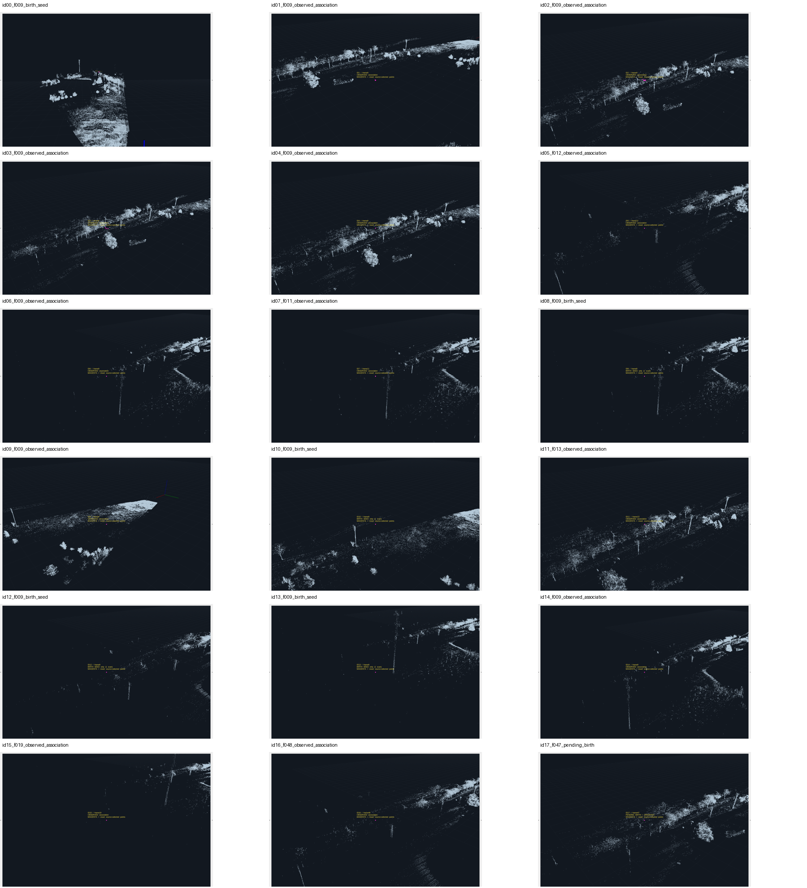
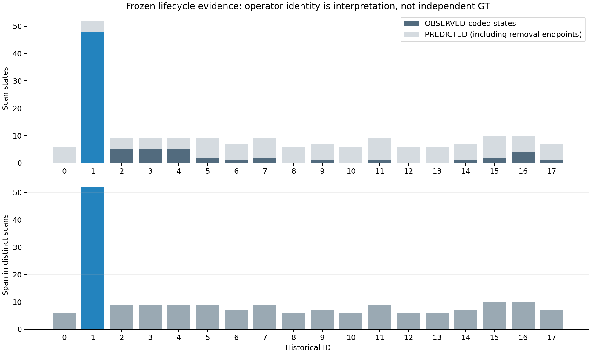

# 历史动态植被 / false-track机制审计

日期：2026-10-16。**VERIFIED RESULT：冻结数值的birth/pending/关联复用核查完成；VISUAL REVIEW：18个ID均检查实际seed或OBSERVED支持；OPERATOR_VISUAL_IDENTITY：仅ID1由用户在RViz指认为实际UAV。** 不是独立GT、检测性能测试或新算法实验。

**当前证据更支持优先处理track initiation/confirmation，而不是继续收紧点级过滤。** 最直接证据是：第9帧35个refined点产生15个立即active的ID，其中11个组件只有1点；ID15和ID17的pending晋升分别只依赖3和4个不同扫描；多个ID重复使用同一组实际返回。它们是明确的源码/账目事实，不能由“还有树叶点”一项解释。

但不把所有非ID1认证为植被或false GT。逐ID判断为：1个operator identity、4个vegetation-associated、3个duplicate/fragment、10个UNKNOWN。**“大多数剩余点物理上都是动态树叶”仍未建立**；用户的整体场景观察与部分逐ID图像相符，不能替代未确认ID的身份。

结果：[results/dynamic_vegetation_false_track_audit/](results/dynamic_vegetation_false_track_audit/README.md)。没有改动历史源码、height/occupancy/density/Doppler等阈值、E18、GNSS/calibration、原labels、PCD或既有结果；没有跑新score、feature组合、分类器、阈值搜索或“只剩ID1”的反事实过滤。STOP_DEV_FEATURE_MINING有效。未commit/push。

## 1. 输入冻结与取证方法

输入为既有[historical reproduction](results/historical_pcd_baseline_reproduction/README.md)的tracker/association/DBSCAN/pending/removal/summary/terminal CSV、原stdout及现有RViz工作流已验证的60帧阶段快照。原源码只读，用于解释事件。没有读取GNSS或DEV_SILVER，没有重新运行点级滤波或完整tracker。

[frozen_input_identity.json](results/dynamic_vegetation_false_track_audit/frozen_input_identity.json)保存既有结果与历史源码SHA-256。数值脚本[audit_frozen.py](results/dynamic_vegetation_false_track_audit/audit_frozen.py)从冻结实际选择恢复点成员：沿原30m查询范围和原DBSCAN eps2/minPts1获得已有cluster的membership，**选择来自冻结association表，未重新排名/关联**。第9帧birth组件与原15行初始化日志逐项核对；52帧remaining组件和所有pending行均与冻结表核对。

晋升时的完整pending观察列表原来没有存盘。因此此处是**RECONSTRUCTED SOURCE SEMANTICS**：只把原源码中pending bookkeeping代码块原样作用于冻结remaining candidates，并附加scan_index用于记账；不执行filter、完整track_frame、预测、移除或新评分。要求每帧pending IDs、累计条数、lost_count、末次XYZ/velocity完全一致，三次promotion ID及位置也一致，才接受其hidden observation lineage。验证见[numeric_validation.json](results/dynamic_vegetation_false_track_audit/numeric_validation.json)。它不是声称原日志直接保存了scan列表。

图像由真正RViz渲染：stored云作灰色场景，**仅冻结birth或OBSERVED成员点**作magenta高亮。预测中心/预测线全部关闭；未按视觉标签更改过滤或选择规则。47幅原RViz窗口截图覆盖所有非ID1的实际OBSERVED-coded状态及14个非ID1初始seed；ID1保存9/30/60帧并结合用户已检查的往返轨迹。没有用预测坐标生成“物体证据”。[rviz_inspection_manifest.csv](results/dynamic_vegetation_false_track_audit/rviz_inspection_manifest.csv)保留身份及请求的视角；相机只影响显示，不是测量或空间mask。

## 2. 身份证据与逐ID视觉表

用户新提供的ID1身份只存入本轮解释层：`OPERATOR_VISUAL_IDENTITY`。表中允许值`UAV_OPERATOR_CONFIRMED`的含义限于此，**不是independent ground truth**，不回写80个DEV_SILVER或任何旧label。其它分类来自assistant对RViz场景上下文的审查及冻结点成员复用证据，没有冒称得到额外逐ID操作者确认。

“VEGETATION_ASSOCIATED”只表示实际候选点邻近圆团状/枝状冠层返回；不能独立认证树种、叶片运动或同一枝叶连续身份。`HIGH_FOR_REUSE`只表示共享点成员的算法证据强，不是物体类别置信度。

| ID | visual_class | confidence | 实际取证扫描及理由摘要 |
|---:|---|---|---|
|0|UNKNOWN|LOW|9 seed；单点在稀疏/细竖向与冠层边缘场景，之后全预测，身份不明|
|1|UAV_OPERATOR_CONFIRMED|OPERATOR_REPORT|9/30/60及用户交互检查；中央上方开放空域横向往返，operator身份而非独立GT|
|2|VEGETATION_ASSOCIATED|MEDIUM|9–13；实际支持位于树冠/枝状返回及邻近，跨位置关联不等于同一叶片运动|
|3|VEGETATION_ASSOCIATED|LOW|9–13；邻近树列上缘，部分点离开密集表面，保留低置信度|
|4|DUPLICATE_OR_FRAGMENT|HIGH_FOR_REUSE|10–13与ID2逐帧使用完全相同点集；9另有真实seed|
|5|UNKNOWN|LOW|9 seed、12/13关联；细竖向结构附近，杆/枝身份不清|
|6|DUPLICATE_OR_FRAGMENT|HIGH_FOR_REUSE|9关联复用ID8真实seed；同一扫描换配，不是预测物体证据|
|7|UNKNOWN|LOW|9 seed、11/12关联；高位稀疏/竖向结构，不强判枝叶|
|8|UNKNOWN|LOW|仅9真实seed，post-update无OBSERVED；之后预测不用于类别判断|
|9|UNKNOWN|LOW|9 seed与关联；近端平坦/低场景边缘，地形/结构/植被不明|
|10|UNKNOWN|LOW|仅9 seed；细竖向结构附近，之后无观测支持|
|11|VEGETATION_ASSOCIATED|MEDIUM|9 seed、13实际关联；13在冠层邻近，不能把不同位置串成同一叶片轨迹|
|12|UNKNOWN|LOW|仅9 seed；稀疏/竖向结构，之后全预测|
|13|UNKNOWN|LOW|仅9 seed；竖向结构性质不明，之后全预测|
|14|DUPLICATE_OR_FRAGMENT|HIGH_FOR_REUSE|9关联复用ID6真实seed，seed与关联高度明显不同，同扫描不能解释为真实位移|
|15|UNKNOWN|LOW|15 pending birth、19关联；远端细竖向/稀疏结构，不强行判植被|
|16|UNKNOWN|LOW|47 birth、48/49/53关联；位置跳变大、场景来源混杂，不能当单一真实运动|
|17|VEGETATION_ASSOCIATED|MEDIUM|47 pending birth邻近圆团状冠层；之后无OBSERVED，叶片运动未独立确认|

完整位置描述、理由、provenance：[track_visual_identity.csv](results/dynamic_vegetation_false_track_audit/track_visual_identity.csv)。没有强制用完全部允许类别；本次未认证任何`ISOLATED_TRANSIENT`，不靠孤立点外观替代未知身份。

## 3. 生命周期：把实测支持与预测延续分开

全部指标在[track_lifecycle_summary.csv](results/dynamic_vegetation_false_track_audit/track_lifecycle_summary.csv)。`first_scan`至`last_scan`包括冻结的移除当帧terminal状态；各扫描只计一次。OBSERVED/PREDICTED按原状态编码统计；ID15/16/17的晋升当帧是实际pending birth、并非额外一次local association，但原CSV编码OBSERVED，计数保留并明确披露。初始15个seed单列，不重复计为后续OBSERVED association。

空间跨度/累计XY/median/max位移**只用OBSERVED-coded实际状态**；prediction造成的all-state跨度另列，不能冒充真实物体运动。无OBSERVED时空间指标UNKNOWN，不能写成“物理不动”；仅1个OBSERVED时span=0是样本事实，也不能判断静止。累计位移连接相邻观测，跨gap的连接只是端点距离，不是连续真轨迹。自然gap定义为相邻observed扫描索引差>1（至少一帧未观测），并保存所有缺失扫描数；没有根据分离结果挑一个“long”门限。起止处未观测不算内部gap，prediction数另报。

|ID|first–last|span scans|OBS / PRED|OBS fraction|observed x/y/z spans (m)|结束原因|
|---:|---|---:|---:|---:|---|---|
|0|9–14|6|0/6|0.0%|UNKNOWN|lost|
|1|9–60|52|48/4|92.3%|5.54 / 64.92 / 1.95|active_at_end|
|2|9–17|9|5/4|55.6%|35.71 / 39.76 / 14.57|unstable|
|3|9–17|9|5/4|55.6%|1.49 / 46.62 / 4.18|unstable|
|4|9–17|9|5/4|55.6%|35.71 / 38.28 / 14.57|unstable|
|5|9–17|9|2/7|22.2%|0.005 / 0.44 / 0.03|unstable|
|6|9–15|7|1/6|14.3%|0 / 0 / 0|lost|
|7|9–17|9|2/7|22.2%|26.60 / 1.14 / 1.62|unstable|
|8|9–14|6|0/6|0.0%|UNKNOWN|lost|
|9|9–15|7|1/6|14.3%|0 / 0 / 0|lost|
|10|9–14|6|0/6|0.0%|UNKNOWN|lost|
|11|9–17|9|1/8|11.1%|0 / 0 / 0|unstable|
|12|9–14|6|0/6|0.0%|UNKNOWN|lost|
|13|9–14|6|0/6|0.0%|UNKNOWN|lost|
|14|9–15|7|1/6|14.3%|0 / 0 / 0|lost|
|15|15–24|10|2/8|20.0%|0.83 / 5.40 / 0.37|unstable|
|16|47–56|10|4/6|40.0%|77.51 / 11.55 / 3.42|unstable|
|17|47–53|7|1/6|14.3%|0 / 0 / 0|lost|

**VERIFIED RESULT：** ID1有48 observed、52扫描跨度；其余17个ID只有0–5 observed、跨度6–10扫描。其中5个ID（0/8/10/12/13）在birth后没有任何post-update OBSERVED；另有5个仅1个。它们在画面里“活着数帧”大量来自预测预算，并不表示物体连续存在。

ID1 observed XY bounding-box对角约65.16m，累计observed XY端点位移181.78m，median/max相邻观测位移3.640/11.389m，4个内部缺测gap。与用户所述横向往返一致；首尾接近不表示静止。**反例保留：** ID16 observed X跨度77.51m、累计端点位移81.22m，不能说“ID1的所有空间幅度都最大”。ID2/3/4也有几十米关联跨度，可能包含跨结构换配；没有把这些数值当物理叶片速度或新的判别式。

## 4. 第9帧birth事件的精确语义

- 先经过8次背景学习空输出；第9帧refined=35。main只检查总dynamic数≥5才尝试首次初始化，不要求每个组件≥5。
- 全局DBSCAN为原eps2/minPts1：**15个组件、0 noise**，sizes为`[1,9,10,3,1,2,1,1,1,1,1,1,1,1,1]`，总35。11个singleton。
- 组件按原`set(labels)`顺序对应IDs0–14，详情[birth_forensics.csv](results/dynamic_vegetation_false_track_audit/birth_forensics.csv)。每个组件直接构造`SingleTargetTracker`，`is_active=True`并加入输出池；**没有经过pending的6-observation规则，没有distinct-frame确认，只有一个扫描**。
- 初始化完成后，同一个第9帧马上调用`track_frame`。它不是第二帧独立证据，也会让history entries首帧重复。源码打印“14个聚类”来自固定`len(unique_labels)-1`，本帧无noise，实际15组件/15ID；不以错误console计数替代labels。

**一个cluster会不会seed多个ID？** 严格说同一次global初始化中每个DBSCAN label只seed一个ID，组件点成员互不相交。一个真实物体可能碎成多个组件，但本次没有独立身份来计物理物体数。随后同一扫描的local association则允许一个真实点集再次支持其它ID：ID6的birth seed被ID14关联，ID8的birth seed被ID6关联，见[initial_seed_reuse.csv](results/dynamic_vegetation_false_track_audit/initial_seed_reuse.csv)。这不是同组件被循环seed两次，而是birth之后立即发生跨ID换配/复用。

**多个ID后来是否共享cluster？** 是。第10/11/12/13帧，ID2与ID4分别共享5/3/2/1个refined点，且每帧两者是**完全相同点集**。[duplicate_association_events.csv](results/dynamic_vegetation_false_track_audit/duplicate_association_events.csv)。源码`used_indices`仅用于后面的remaining candidates，不从后续existing tracker的local search中移除，因而不保证one-to-one association。

源码依据：`target_track_without_initialize_and_grid.py` 565–606（全局初始化）、616–705（local association）、710–714（remaining mask）、1092–1118（首次初始化并同帧track）。不修改源码。

## 5. Pending的六条记录不等于六帧

|晋升ID|pending ID|晋升scan|stored observations|distinct scans（完整池）|最近6条对应扫描|最近6条distinct scans|
|---:|---:|---:|---:|---:|---|---:|
|15|9|15|6|3|13,14,14,14,15,15|3|
|16|6|47|50|27|44,45,45,45,47,47|3|
|17|18|47|7|4|44,45,46,46,47,47|4|

[pending_distinct_frame_audit.csv](results/dynamic_vegetation_false_track_audit/pending_distinct_frame_audit.csv)含完整scan序列、重复同帧条数和标志；[pending_scan_history.csv](results/dynamic_vegetation_false_track_audit/pending_scan_history.csv)含逐扫描pool历史。**ID15和ID17在不足6个不同扫描时实际晋升；不是仅由源码推测可能发生。** ID16完整池已有27个扫描，不能说所有晋升都“太快”；但最近六条运动检查仍只有三个时刻。pending pool可以长存并混合候选，这本身反驳“所有clutter物理上只存在很短时间”的强版本。

源码743–817：在`for cand in candidates`中搜索所有未confirmed pending，没有排除本扫描已匹配的pid；`matched_pending`只在后面的丢失清理使用。同一扫描后续候选可再次向同pid append。检查的是`len(observations)>=6`及最近六条**位置记录**的几何稳定性，没有按timestamp/scan去重，没有用真实dt；同帧的空间差异也进入所谓运动向量。只要条件通过就晋升。new pending当帧未匹配时也会增lost_count；这些原语义均保留。

## 6. Point、track和birth分别判断

**POINT LEVEL — 仍有植被关联候选：** 逐ID场景图支持ID2/3/11/17的部分实际refined支持邻近冠层；D阶段并非纯UAV点云。用户整体观察与此一致。它不证明每个点都是运动叶片，不能统计“物理植被占比”，也没有证明这些点必须在点级全部删除。

**TRACK LEVEL — 植被关联ID主要短暂/预测占比高：** 这4个视觉关联ID的active跨度7–9扫描，OBSERVED-coded数量1–5，最终均移除；ID1则48次实际状态支持、52扫描并最终存活。其它UNKNOWN及duplicate ID同样短，但不据此改成“认证植被”。短ID不等于植被本身短暂存在；ID16此前pending pool的长期混合证据必须保留。

**BIRTH LEVEL — 证据最直接：** 首次15个ID整体绕过确认，11个只由singleton触发；后续两个晋升不足6个不同扫描；短轨迹的可见寿命又由prediction延续放大。初始已经筛到很少点，仍把每个组件立即当active track，是与本次用户困惑直接对应的机制。point-level残留和track-level过度承诺可以同时存在，不能靠继续删点替代确认语义。

**优先级判断（解释，不是新结果）：** 在这个已检查历史序列中，track birth/confirmation是更有直接证据的下一瓶颈。尚无held-out false-track评估来证明其在所有场景中占误警的比例。也没有反事实试验声称一个新规则能“只留ID1”，或保证不损害稀疏UAV。

## 7. 边界与未做之事

没有用视觉表拟合/组合height、intensity、velocity、occupancy、density、geometry；没有AUC、precision、recall、分类器、回归、阈值/score weight、DP或E18重跑。视觉表不是训练集或新的GT发布。常量2m/30m/60m/6条等均是原源码语义，不是本轮选出的阈值。改变相机和高亮点大小只为取证，不改变科学点值或算法ROI。

源码与既有结果hash最终保持一致。审计工具开发中捕获了float32 reduction次序差异、原DBSCAN loop-trace重复行及一次RViz未完成加载的pilot图，均在[instrumentation_notes.md](results/dynamic_vegetation_false_track_audit/instrumentation_notes.md)说明；未通过改算法/容差来掩盖差异。原结果未回写。

## 8. Final decision

**1. Does dynamic vegetation remain after the historical point-level filters?**

有植被冠层关联的refined候选仍在，支持用户观察；“具体运动叶片”没有独立认证，不能把全部残留点都叫植被或UAV。

**2. Does vegetation usually create long-lived tracks, or mostly transient IDs?**

本次视觉植被关联ID主要是短暂ID、1–5个OBSERVED-coded支持，预测延续占了较多生命周期；并非ID1式长轨迹。但pending候选池可长期存在，不能推出物理植被本身短暂。

**3. Is ID1 qualitatively distinct at track level without using GNSS?**

是。operator身份、开放空域往返外观，以及48个OBSERVED状态/52扫描支持一致；其它ID最多5个OBSERVED。空间跨度不是普适分离条件，ID16是明确反例。这不是独立性能或GT。

**4. Is the dominant next bottleneck point filtering or track initiation/confirmation?**

当前更应优先审查track initiation/confirmation：首次单扫描直接active、同帧重复观察晋升和关联复用均有直接证据。尚未建立跨场景误警因果占比，不能宣称点过滤已经完美。

**5. If exactly ONE algorithmic modification were allowed next, what should it be?**

**PROPOSED ONLY：让所有新track（包括首次全局初始化）先进入tentative状态，只有来自不同时间扫描的确认支持才能转为confirmed。** 不在本任务实现，也不根据这些ID反推所需帧数/阈值或保证只保留ID1；实施前须另行冻结规则，并用独立身份与target-absent/held-out证据同时检验误轨迹、真实稀疏目标丢失及确认延迟。
