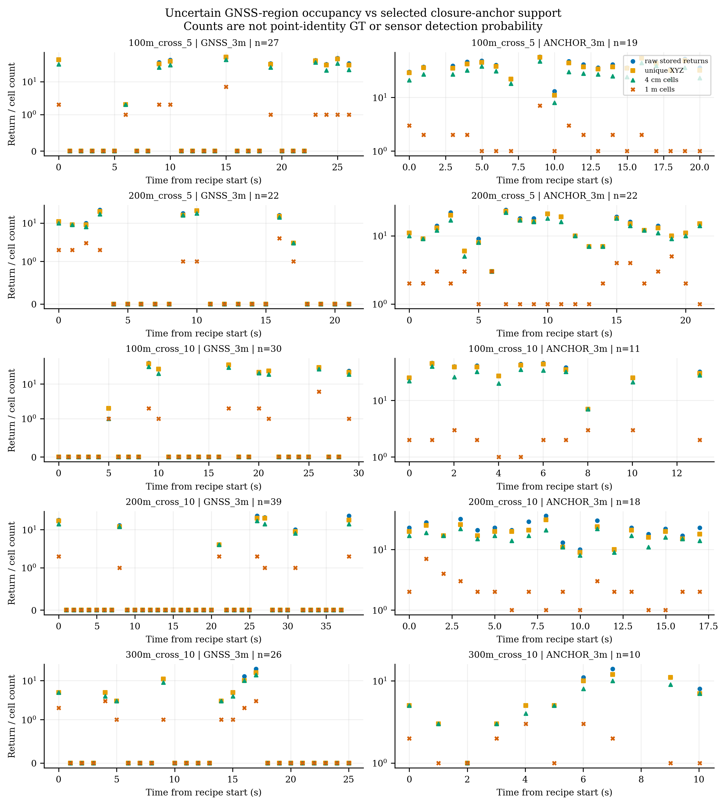
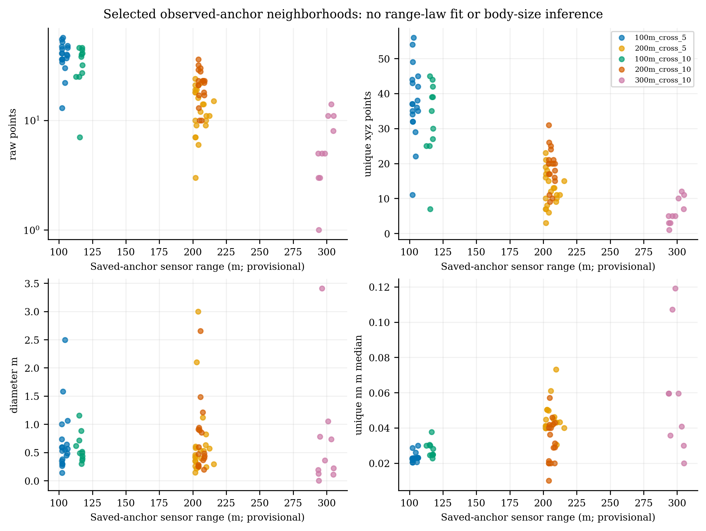
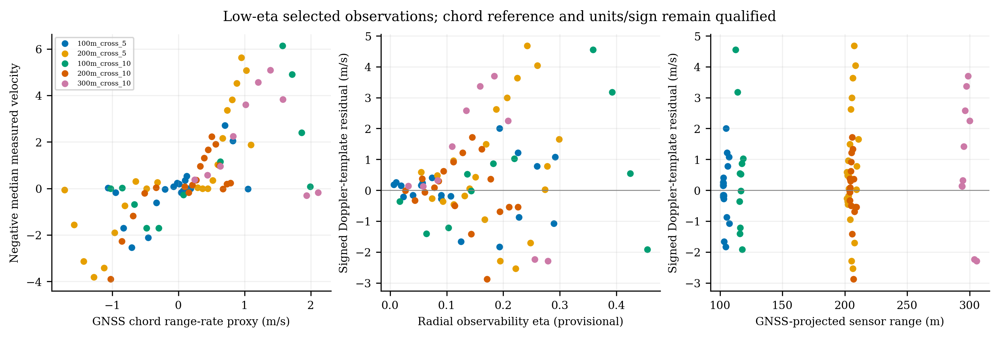

# FMCW GNSS-conditioned UAV phenotype

Status: **COMPLETED — oracle-conditioned descriptive extraction and source validation.** Date: 2026-10-12. This is not a new detector, tracker or benchmark result. E18 remains frozen; no Doppler term, score weight, graph, silver label or 3 m evaluation gate was changed.

**Main outcome:** the five PASS sequences support a reproducible description of selected UAV-like returns, but not an unbiased sensor non-return model or validated UAV/clutter likelihood. GNSS 3 m regions are empty in 103/144 supported frames; selected closure-anchor regions are nonempty in all 80 observations. One-metre representation turns 31/80 observations into singleton cells, versus only 1/80 singleton unique-XYZ observations. Most small matched controls are empty, severely limiting feature comparisons.

## Material Passport

- Origin Skills: academic-research-suite (run/validate); academic-plotting (local numerical charts).
- Origin Date: 2026-10-12; Version Label: gnss_conditioned_phenotype_v1.
- Verification Status: **ANALYZED**, with independently source-validated extraction/count/geometry artifacts; not independently verified positional/point-identity GT or a repeated full-study reproduction.
- Cohort: five closure-PASS cross sequences; DEV/SILVER and oracle-conditioned evidence only.
- Reproducibility: protocols, code/input hashes, extraction/summary/figure commands, environment, raw archive/member identities and independent audit definitions retained. Geometry/rich audit command text is captured; the separate statistical check records methods/source hashes, not a standalone executable validator. Failed attempt 01 remains visible.

## 1. Evidence boundary and source audit

Sources are the unchanged [workbook](bag/20260205/飞行轨迹坐标.xlsx), [closure alignment](results/calibration_closure/alignment.json), [alignment results](results/calibration_closure/alignment_results.csv), existing raw-frame inventories, and 80 observed, non-interpolated [DEV/SILVER anchors](results/research_dev_v0/silver_labels.csv). Direct workbook parsing crosschecks all 72 GNSS rows, including the device origin, against the existing E20 cell provenance. Unknown N/E/V/Q and unlabeled columns stay opaque.

Independent exact per-frame UAV-center truth, RTK precision, clock-offset confidence bounds, antenna lever arm, body attitude/aspect, and scan/FOV coverage remain **UNKNOWN**. No unobserved frame is a negative label. This analysis cannot erase E20's negative/hover **DATA_GAP** and must not supply independent test evidence.

Two distinct exploratory products are prespecified and hash-frozen before this extraction (not externally preregistered or previously unseen data):

1. **GNSS-conditioned occupancy**: every nominally supported frame, including empty neighborhoods. These are uncertain localization regions that can contain clutter or miss the actual UAV.
2. **Observed-anchor return phenotype**: raw neighborhoods around the unchanged 80 closure-localized observations. These have stronger localization evidence but are selected on prior LiDAR observability and are not point-identity GT. They cannot estimate unconditional UAV non-return probability.

The four failed/ambiguous February sequences remain separately inventoried; their rich clouds are not pooled into this analysis or relabeled as negatives. This first stage covers cross-flight only; radial, hover and high-observability claims would be unsupported.

## 2. Verified preparatory geometry

The following accounting was first established from existing frame metadata and is now independently checked against the completed raw-bag extraction. Machine-readable evidence: [raw frames](results/gnss_conditioned_uav_phenotype/run_02/frames.csv), [preparatory accounting](results/gnss_conditioned_uav_phenotype/preparatory_accounting.csv), and [independent geometry audit](results/gnss_conditioned_uav_phenotype/run_02/independent_geometry_audit.json).

| Sequence | Existing frames | Nominal GNSS-supported | Observed anchors | Anchors inside existing scenario union of 3 m balls |
|---|---:|---:|---:|---:|
| 100m_cross_5 | 32 | 27 | 19 | 19 |
| 200m_cross_5 | 83 | 22 | 22 | 16 |
| 100m_cross_10 | 46 | 30 | 11 | 9 |
| 200m_cross_10 | 48 | 39 | 18 | 12 |
| 300m_cross_10 | 63 | 26 | 10 | 8 |
| Total | 272 | 144 | 80 | 64 |

**VERIFIED RESULT:** 64/80 anchors fall inside the existing sensitivity union. Thus even that union is not a certified conservative UAV-location bound. Small GNSS balls cannot be treated as exact target segmentation.

| Sequence | Anchor–nominal GNSS distance, median / max (m) | Scenario displacement from nominal, median / max (m) | Nominal chord eta, median / max |
|---|---:|---:|---:|
| 100m_cross_5 | 3.736 / 6.350 | 5.986 / 6.980 | 0.090 / 0.292 |
| 200m_cross_5 | 5.317 / 26.575 | 9.990 / 10.958 | 0.179 / 0.298 |
| 100m_cross_10 | 5.836 / 10.509 | 7.337 / 7.785 | 0.133 / 0.455 |
| 200m_cross_10 | 4.977 / 12.163 | 9.153 / 11.631 | 0.178 / 0.378 |
| 300m_cross_10 | 5.061 / 8.787 | 19.176 / 19.992 | 0.177 / 0.301 |

Scenario-displacement columns summarize each frame's **maximum** displacement over existing scenarios. They are sensitivity envelopes, not confidence intervals or GNSS error estimates. Eta uses provisional nominal alignment and coarse GNSS chords; all these supported frames are cross-dominant by the radial/tangential decomposition. There is no high-eta radial comparison in this cohort.

Supported provisional GNSS-to-sensor range intervals are 102.494–107.525, 201.703–211.017, 105.946–118.534, 203.899–220.167, and 293.808–307.576 m in the table's order. Corresponding chord-speed intervals are approximately 1.74–3.65, 3.93–5.77, 2.61–4.66, 3.48–5.98, and 5.21–7.57 m/s. Within-sequence range variation is limited and nominal 5/10 m/s is not measured speed. Eta-bin counts are 45 below 0.1, 48 in [0.1,0.2), and 51 in [0.2,0.5); none reaches 0.5. The initial GNSS chord has no nominally supported LiDAR frames in `200m_cross_5` or `300m_cross_10`.

### Coordinate and time definitions

- Raw sensor coordinates are retained, with the established analysis transform `[sensor_x, sensor_z, -sensor_y]`; no axes were manually adjusted.
- Device-coordinate GNSS origin: latitude 31.83749046°, longitude 118.76606266°, ellipsoidal height 25.544 m. Lat/Lon/Ellh are converted through WGS84 ECEF to local ENU.
- GPS week/TOW uses the existing explicit GPS–UTC difference of 18 s for the acquisition date. Bag-record time, filename time and ROS header time remain separate; the historical header epoch is inconsistent with the acquisition epoch.
- Query time is `bag_record_time + saved_sequence_offset`; no offset is refitted. Existing shared six-DoF transform is reused as `p_sensor = R p_ENU + t`.
- Only piecewise interpolation within GNSS endpoints is permitted. Each cross sequence has four GNSS samples; velocity is an endpoint chord divided by its **actual** interval, not instantaneous flight speed. Interior derivative knots are flagged. Neither a short chord nor a filename speed establishes hover or actual speed.
- `range_m`/`range_bin_m` refer to the provisional GNSS-to-sensor range. `anchor_range_m` and `region_reference_range_m` retain observed-anchor range separately. Neither is exact per-frame UAV-center truth.

## 3. Frozen descriptive definitions

The original [protocol](results/gnss_conditioned_uav_phenotype/protocol.json) predates the failed extraction. The [run_02 protocol](results/gnss_conditioned_uav_phenotype/run_02/protocol.json) contains the same scientific definitions and source identities, with an export-only source correction. No full-cohort outcomes were used to select these definitions.

### Regions and return support

GNSS nominal balls have radii 1/3/10 m. The existing sensitivity scenarios produce a separate union of 3 m balls. Saved observed anchors use 1/3 m balls; absent anchors are never interpolated. All finite XYZ with at least one nonzero coordinate are retained, without intensity, height, Doppler, background, neighborhood or clustering filters. These radii are localization sensitivity recipes, not UAV-size rules or evaluation gates.

Counts distinguish raw stored returns, exact unique XYZ, coincident returns, and fixed-zero-origin 4 cm/1 m occupied cells. Arithmetic voxel means use exactly the same raw children. Empty-region counts are zero but empty feature summaries are missing; singleton spans/covariance/diameter are mathematically degenerate and never interpreted as body dimensions. NN and MST are undefined for insufficient support, not zero.

Exact raw/unique NN is uncapped. Diameter, pairwise distances and unique-XYZ MST use a fixed 2,000-unique-point computational limit; over-budget quantities remain missing with an explicit flag, without trimming region counts or replacing them with sampled maxima.

Empirical 0/1/2/>2 frequencies describe **region occupancy**, not physical UAV detection probability. Empty runs use real timestamps and are censored at support boundaries, GNSS chord changes, missing frame indices or outages longer than twice median bag cadence. Missing saved localization is an observation-availability gap, not sensor non-return.

### Matched local clutter proxies

Each region is rotated about the fixed analysis frame's z axis by −20°, −10°, +10°, +20°, preserving reference range/elevation and region shape **in `[sensor_x,sensor_z,-sensor_y]`**, not independently surveyed vertical. Eligibility is geometry-only and decided before counting. A proxy must be disjoint from the GNSS sensitivity tube, the nominal GNSS 3 m ball, the available observed-anchor 3 m ball, and its analyzed region. Rejections are recorded; controls are never chosen by apparent feature quality.

These regions are **LOCAL_CLUTTER_PROXY**, not certified target-absent controls. Unknown FOV coverage/occlusion and possible other movers remain confounders. Eligible controls can overlap each other and are not independent observations. Scenario-union geometry describes localization uncertainty plus possible clutter, not UAV structure.

### Rich fields and Doppler

The rich decoder preserves named types, counts, offsets, endian and row padding. Full-frame field counts and complete valid-XYZ quantiles are audited, along with ring-row, time-index, radius-norm and sign-field relationships. Per-point time is not used to deskew without documented units/anchor. Undocumented acceleration, direction and surface-evenness fields are not physical GT.

Historical dataset sign convention is retained explicitly: `velocity ≈ −dr/dt`. Both `−median(velocity) − GNSS_chord_range_rate` and the opposite-sign diagnostic are exported, also for `velocity0`, without fitting a scale or choosing the better sign. Existing scenario range-rate envelopes provide sensitivity intervals, not error confidence bounds. Proxy residuals use the hypothetical UAV-motion template; they are not error against the proxy object's true velocity.

### Exploratory feature comparison

Strata preserve conditioning recipe, sequence, nominal range, provisional 25 m range bins and eta bins `[0,.1,.2,.5,1]`. Same-frame matched AUC uses `P(UAV-conditioned value > proxy value) + 0.5 P(tie)`, averaging eligible controls within each frame, then frames equally. Direction is not flipped to make a feature look useful. Cliff's delta is `2 AUC − 1`; paired differences and IQR-scaled effects retain feature-specific missingness.

These are descriptive proxy-region contrasts, not operational precision, independent test AUC or likelihood-ratio calibration. No score threshold, classifier, probability model, transition prior, learned weights, parameter search, IID confidence interval or p-value is fitted.

## 4. Actual raw support and spatial structure

All 272 rich messages were read without preprocessing rejection. They contain **340,000,000 organized storage slots**, of which **30,941,328** have finite, nonzero XYZ. An empty organized slot is not automatically a physical missed ray; ray identity/exposure semantics are undocumented. Exactly 144 frames have nominal GNSS support. There are 736 UAV-conditioned recipe/frame records and 2,866 eligible local-clutter-proxy records, for 3,602 region records in total. No target-point segmentation is inferred from the raw cloud itself.

### Region occupancy is not physical missed-detection probability

Pooled counts below are empirical frequencies within each frozen recipe. Dividing by the denominator gives the requested conditional occupancy frequencies; complete per-sequence/range/eta and representation versions are retained in [support frequencies](results/gnss_conditioned_uav_phenotype/run_02/support_frequencies.csv) and [representation support frequencies](results/gnss_conditioned_uav_phenotype/run_02/representation_support_frequencies.csv).

| Recipe | Frames | 0 stored returns | 1 | 2 | >2 |
|---|---:|---:|---:|---:|---:|
| GNSS 1 m | 144 | 133 (92.36%) | 1 | 0 | 10 |
| GNSS 3 m | 144 | 103 (71.53%) | 0 | 2 | 39 |
| GNSS 10 m | 144 | 26 (18.06%) | 2 | 4 | 112 |
| Existing-scenario union of 3 m balls | 144 | 42 (29.17%) | 1 | 1 | 100 |
| Selected observed-anchor 3 m | 80 | 0 | 1 | 0 | 79 |

This large recipe sensitivity is a **VERIFIED RESULT**, not evidence that a sensor miss rate is 71.53% or that increasing a detection gate is beneficial. Wider regions can recover actual support and add clutter. All 80 anchor frames are nominally GNSS-supported; the 64 other supported frames without saved observations are not certified target misses. Closure selection already used LiDAR trajectory and Doppler-consistency evidence, so these observations cannot independently validate Doppler's detection value.

| Sequence | GNSS 3 m empty / supported | Longest contiguous 3 m empty run, frames / sample span (s) | Selected anchors | Median raw / unique / 4 cm / 1 m support |
|---|---:|---:|---:|---:|
| 100m_cross_5 | 17/27 | 5 / 3.984 | 19 | 40 / 37 / 27 / 1 |
| 200m_cross_5 | 14/22 | 5 / 4.009 | 22 | 13 / 12.5 / 11.5 / 2 |
| 100m_cross_10 | 22/30 | 6 / 5.018 | 11 | 38 / 35 / 28 / 2 |
| 200m_cross_10 | 32/39 | 8 / 6.992 | 18 | 22.5 / 20 / 16.5 / 2 |
| 300m_cross_10 | 18/26 | 8 / 6.993 | 10 | 5 / 5 / 5 / 1.5 |

Runs break at GNSS chord boundaries/support gaps/outages; single-sample runs have sample span zero, not duration zero. [Run records](results/gnss_conditioned_uav_phenotype/run_02/region_empty_runs.csv) retain bracket times and censoring. Seventy supported zero-region runs cover 304 zero rows across the different GNSS recipes—not 304 distinct sensor misses. The 28 observation-gap records are separate. Anchor availability gaps are not interpreted as raw non-return.



### Spatial phenotype on the 80 selected observed anchors

Values are medians of frame-level descriptors in the 3 m anchor recipe, not body dimensions. Raw XYZ, unique-XYZ NN/pairwise/MST, covariance eigenvalues, axis spans, range thickness and line-of-sight radial/tangential spread are available per region in [region features](results/gnss_conditioned_uav_phenotype/run_02/region_features.csv).

| Sequence | Diameter (m) | Unique-NN (m) | Maximum MST edge (m) | Radial RMS / tangential RMS (m) | Intensity median |
|---|---:|---:|---:|---:|---:|
| 100m_cross_5 | 0.543 | 0.0228 | 0.245 | 0.079 / 0.112 | 41.5 |
| 200m_cross_5 | 0.443 | 0.0412 | 0.220 | 0.051 / 0.158 | 29.5 |
| 100m_cross_10 | 0.491 | 0.0248 | 0.216 | 0.072 / 0.129 | 38.0 |
| 200m_cross_10 | 0.479 | 0.0338 | 0.240 | 0.063 / 0.143 | 30.25 |
| 300m_cross_10 | 0.292 | 0.0595 | 0.278 | 0.042 / 0.113 | 23.5 |

The 300 m NN/MST summaries have nine defined frames; its singleton has no NN or MST. Tangential support RMS is larger than radial RMS at the sequence-median level, but this does not establish UAV orientation. Median covariance eigenvalues (largest to smallest, m²) are approximately `(0.01173,0.00371,0.00202)`, `(0.02235,0.00296,0.00112)`, `(0.01531,0.00534,0.00169)`, `(0.01775,0.00434,0.00134)`, and `(0.01375,0.00072,0.000006)` in the same order. Low rank at low support is partly algebraic/selection-dependent, not a learned physical manifold or position-uncertainty covariance.

Across nominal groups, selected support generally decreases and unique-NN spacing increases toward 300 m. **Within sequences this is not a stable monotonic range law:** Spearman rho between observed-anchor range and raw support is −0.007, −0.113, +0.370, −0.215, and +0.778; between the same range and unique-NN it is +0.460, +0.313, −0.318, +0.294, and −0.450. These descriptive, temporally dependent associations are neither causal nor significance-tested. Range is confounded with sequence, chord state and selection; body aspect remains UNKNOWN. Full [within-sequence associations](results/gnss_conditioned_uav_phenotype/run_02/within_sequence_associations.csv) preserve both GNSS-derived and anchor-range versions.



### Representation artifacts and coordinate coincidence

Across the same 80 anchor neighborhoods, **summing frame-wise counts** gives 1,883 stored rows, 1,756 unique XYZ positions, 1,446 occupied 4 cm cells, and only 161 occupied 1 m cells; these are not globally deduplicated positions/cells across time. Raw/unique/4 cm representations each have one singleton observation; the 1 m representation has **31 singleton and 30 two-cell observations**. Thus a singleton cell frequently represents multi-return support, not physical sensor singleton observation. Coarse cell-mean diameter is mathematically zero when all children collapse into one cell; this is not zero-size UAV evidence.

There are 127 excess coincident-XYZ rows in 53/80 observations. The 120 coincident-coordinate groups are **not literal record copies**: all differ in stored `time`, 119 in intensity, 26 in velocity/velocity0, and one in ring; none is identical in all fields or raw bytes. Consequently raw NN zero distances can be coordinate coincidence, while unique-NN describes distinct coordinates. Independent physical-return identity remains UNKNOWN. See [duplicate structure](results/gnss_conditioned_uav_phenotype/run_02/rich_duplicate_structure.csv).

Fixed 1 m versus 3 m anchor recipes have identical raw counts on 74/80 frames; the wider recipe adds only 12 stored rows overall (1,871 versus 1,883). This is a sensitivity result, not permission to choose a target-size gate. Sparse support can underestimate extent; wider neighborhoods can include non-UAV outliers. No invariant body-size prior or new rejection threshold is selected. One broad region exceeds the exact pairwise budget; its counts/NN remain present and capped quantities are explicitly missing.

## 5. FMCW measurements and rich-field semantics

### Doppler versus GNSS-supported range-rate

For each supported frame, `range_rate = e_r^T v_chord` and `eta = abs(range_rate)/(norm(v_chord)+1e-9)`. Historical sign convention remains `measured velocity ≈ −dr/dt`; no sign, scale, time offset or extrinsic was re-estimated. Signed and opposite-sign residuals, velocity0 residuals and existing-scenario residual envelopes remain in the region CSV. Units follow the repository's working m/s interpretation, not a newly verified manufacturer specification.

| Sequence | Median measured velocity / velocity0 | Median absolute `−velocity − GNSS range-rate` (m/s) |
|---|---:|---:|
| 100m_cross_5 | 0.000 / 0.000 | 0.280 |
| 200m_cross_5 | −0.1475 / −0.1493 | 0.951 |
| 100m_cross_10 | −0.0150 / −0.0155 | 1.023 |
| 200m_cross_10 | −0.1700 / −0.1712 | 0.544 |
| 300m_cross_10 | −1.6000 / −1.6011 | 2.242 |

These are medians of frame medians/residuals, not residuals formed from independently pooled medians. Pooling by nominal range gives absolute residual medians 0.662/0.658/2.242 m/s for 100/200/300 m; the retained opposite-sign diagnostic gives 1.041/1.653/2.504 m/s. This does not prove universal sign correctness, calibrated velocity accuracy, or an observability-only explanation for the 300 m mismatch.

Absolute residual versus nominal eta has within-sequence rho +0.711, +0.501, +0.445, +0.598, and +0.648. Eta and provisional range are nearly or exactly rank-collinear in some coarse chords; this cannot identify an independent eta effect. Synchronization/extrinsic sensitivity, sparse GNSS derivatives, potential turns, per-point acquisition time, measurement definition and selected-region contamination remain alternative explanations. There is no independently certified hover or high-eta trajectory here. Low radial velocity can coexist with substantial 3-D motion; conversely a scalar radial reading cannot establish full speed/direction.



### Full-cohort rich-field audit

[Field distributions](results/gnss_conditioned_uav_phenotype/run_02/rich_field_distributions.csv) contain 4,352 field/frame rows; [empirical relationships](results/gnss_conditioned_uav_phenotype/run_02/rich_field_relationships.csv) contain 272 rows. All 16 fields are present and finite in this cohort. **Field names are not semantic documentation.**

| Field | Verified serialized observation | Physical interpretation |
|---|---|---|
| ring | Native uint32; equals organized row 0–7 in every frame. | Row identity established; laser/channel/beam semantics UNKNOWN. |
| time | Native float32; identical monotonic 0–1.249992 ramp on all 2,176 organized rows; no backwards steps. | Units, clock anchor, exposure interval and deskew meaning UNKNOWN. Not converted to absolute acquisition time. |
| acceleration | Zero in all 340 million slots. | Not evidence of zero physical acceleration; placeholder/availability semantics UNKNOWN. |
| acceleration_direction | −1 in every slot. | Sentinel/encoding meaning UNKNOWN; not an independent motion vector. |
| velocity_direction | Exactly equals nonzero scalar velocity's sign throughout. | Redundant empirical sign flag, not independently measured 3-D direction. |
| surface_evenness | Zero in every slot. | No varying roughness/shape evidence; semantics UNKNOWN. |
| velocity / velocity0 | Equal on only 7.79–8.89% of valid-XYZ rows per frame; global `velocity0 − velocity` spans about −2.920 to +3.099. | Relationship/processing origin UNKNOWN; do not assume raw/filtered or two independent measurements. |
| radius | Differs from XYZ norm by at most about 6.1×10⁻⁵ in this cohort. | Empirical redundancy with geometry; naming alone does not certify a separate measurement. |
| intensity | Frame/region distributions retained without intensity rejection. | Uncalibrated field; reflectivity, gain and waveform-quality meanings UNKNOWN. |
| rgba | Zero in every slot. | No varying appearance/color evidence here. |

Observed numeric velocity range is −50 to +50 and velocity0 approximately −52.666 to +52.896. These are **observed values**, not certified ambiguity or saturation limits. Global velocity0 differences do not establish a better Doppler estimator. Undocumented rich fields are not promoted into physical GT or new detector evidence.

## 6. Matched local clutter proxies: informative findings and failure limits

**VERIFIED RESULT:** of all 2,866 matched proxy regions, only 236 are nonempty. For the localized-anchor recipes, all 320 one-metre controls are empty; 311/318 three-metre controls are empty. The matched-control construction is reproducible, but its small-region feature comparison is mostly against empty space with UNKNOWN FOV/exposure—not a representative clutter population. Controls were not moved or reselected after inspecting this result.

| Nominal range | Selected anchor frames | 3 m proxy regions / nonempty | Raw-count AUC / delta | Frames eligible for intensity AUC |
|---|---:|---:|---:|---:|
| 100 m | 30 | 119 / 6 | 0.989 / +0.978 | 6 |
| 200 m | 40 | 159 / 1 | 1.000 / +1.000 | 1 |
| 300 m | 10 | 40 / 0 | 1.000 / +1.000 | 0 |

Count AUC can include empty controls, whereas NN, intensity and Doppler require finite measurements. At 1 m, all non-count feature AUCs are **UNKNOWN**, even though count AUC is 1. The count contrast mostly reflects selecting known return-bearing anchors versus empty matched regions; it cannot be called operational precision or target-versus-clutter classifier accuracy.

For 3 m anchors at 100 m, the six complete-case comparisons show intensity AUC 1.000 (delta +1.000), diameter AUC 0.000 (delta −1.000), and unique-NN AUC 0.000 (delta −1.000). Median paired intensity difference is +13.75 field units; unique-NN difference is −0.0842 m. At 200 m, the only intensity comparison is +4 units (AUC 1); NN is undefined because the sole populated control is a singleton. At 300 m, no such comparison exists. These tiny and differently selected subsets do not establish a cross-range invariant feature.

Broad GNSS 10 m regions permit more complete-case contrasts but are **uncertain target-plus-clutter neighborhoods**, not isolated UAV measurements:

| Feature, fixed higher-UAV direction | 100 m AUC / delta / eligible frames | 200 m AUC / delta / eligible frames | 300 m AUC / delta / eligible frames |
|---|---:|---:|---:|
| Intensity median | 0.933 / +0.867 / 30 | 0.672 / +0.344 / 48 | 0.556 / +0.111 / 9 |
| Unique-NN median | 0.183 / −0.633 / 30 | 0.085 / −0.830 / 47 | 0.400 / −0.200 / 5 |
| Diameter | 0.069 / −0.862 / 29 | 0.253 / −0.493 / 48 | 0.500 / 0.000 / 9 |
| Absolute median velocity | 0.667 / +0.333 / 30 | 0.549 / +0.097 / 48 | 0.500 / 0.000 / 9 |
| Absolute UAV-template Doppler residual | 0.650 / +0.300 / 30 | 0.620 / +0.240 / 48 | 0.278 / −0.444 / 9 |

Negative delta means the conditioned region has a smaller value; direction is never flipped to report apparent performance. In particular, **higher residual AUC is not better Doppler consistency**. At 100/200 m the broad-region residual commonly exceeds the proxy residual; the 300 m comparison reverses, with very large proxy velocities influencing it. Existing-scenario union intensity AUC at 200 m is 0.462 on 13 eligible frames, another null/reversal retained in the full table. None supports choosing a universal feature weight or threshold.

All 3,240 recipe/stratum/feature effect rows, eligibility counts, paired differences, IQR-scaled effects and nulls are retained in [matched exploratory effects](results/gnss_conditioned_uav_phenotype/run_02/matched_exploratory_effects.csv). They are same-frame conditional region contrasts; there are no independently certified negatives or pure-clutter labels.

## 7. Answers A–F and future-model evidence boundary

**A — What determines zero/singleton/multi-return?** Localization recipe and representation demonstrably change the observed category. Selected 300 m support is lower than selected 100 m support, but within-sequence counts do not obey a stable decreasing range law. Actual sensor non-return determinants remain **UNKNOWN** without independent presence/FOV and uncertainty-qualified point identity. Body aspect and instantaneous speed are unobserved.

**B — Which features remain informative after range conditioning?** Intensity and smaller unique-NN/diameter have descriptive contrasts in some same-range neighborhoods, but sparse populated controls, broad-region contamination and inconsistent cross-range/recipe results prevent a verified invariant discriminator. Range-separated raw count/intensity medians are not proof of independent feature value.

**C — What does Doppler reliably measure as eta changes?** It is a scalar field with established empirical sign relationships, not 3-D velocity. Low-eta cross motion can yield near-zero Doppler. Agreement with coarse GNSS range-rate is variable and worsens in these selected 300 m observations; high-eta/hover behavior and a causal eta-error law remain **DATA_GAP / UNKNOWN**. No independent Doppler accuracy or detection gain is claimed.

**D — Which features are representation artifacts?** The 31 coarse singleton cells versus one unique-XYZ singleton is strong same-child representation evidence. Zero coarse diameter, coordinate-coincident raw NN, covariance rank at very low support, and scenario-union extent can all masquerade as target geometry. None should silently become a UAV physical-size prior.

**E — Which features distinguish UAV-conditioned returns from proxies?** Return-bearing anchors are easy to contrast with mostly empty proxies, but that is not a representative clutter test. The few populated small controls and recipe-dependent broad-region effects are exploratory associations only. Reliable occupied-clutter separation is not established, especially at 300 m.

**F — What future forms can be defended as hypotheses rather than fitted models?**

| Future ingredient | What this study actually supplies | What remains necessary |
|---|---|---|
| Node evidence `p(z|UAV)/p(z|clutter)` | Conditional raw/unique support and measurement distributions; representation and empty-control diagnostics. | Independently identified UAV returns, certified/clutter-representative controls, exposure metadata and locked test data. A calibrated likelihood ratio is not identifiable here. |
| Transition prior | Real bag dt and GNSS endpoint-chord direction/speed proxies, with uncertainty/knots recorded. | Dense independent position/velocity and transition/turn timing before estimating speed/acceleration distributions. Nominal commands are not speed gates. |
| Observation / missed-detection model | Recipe-sensitive region occupancy and censored intermittency records. | Independent presence, FOV/occlusion and positional/time bounds, including non-observed target intervals. Anchor-conditioned zero rates cannot estimate `P_D`. |
| Uncertainty-bounded accumulation | Existing offsets/extrinsic sensitivity and demonstrated failure of their union to cover all saved centers. | Independently synchronized clocks, surveyed pose/lever arm and held-out coverage tests. Existing fit envelopes are not defensible probabilistic bounds. |

Possible variables for later hypotheses include range, radial projection, exposure, uncertainty and representation identity. No functional likelihood, score weight, cutoff, classifier or new accumulation method is fitted or selected from this dataset.

## 8. Execution, retained failure and validation

**IMPLEMENTED:** independent diagnostic geometry, rich I/O, statistics and orchestration helpers. **TESTED:** 50 synthetic/integration checks, including out-of-order field byte preservation, endian, padding, uint32, FLOAT64 precision, no GNSS extrapolation, real-time runs and equal-frame effects.

**FAILED:** first full extraction stopped after six frames were seen, before any complete source audit or final cohort CSV was written. NumPy rejected the actual out-of-order PointCloud2 field layout when saving a structured array. [Failure record](results/gnss_conditioned_uav_phenotype/extraction_failed.json) and partial NPZ are preserved. That NPZ is incomplete and must not be consumed as data. No whole-bag SHA or completed study is claimed for this attempt.

**IMPLEMENTED / TESTED export-only correction:** store original point bytes, native named columns, schema, raw-slot IDs and region-membership offsets instead of an unsupported structured NPY dtype. Scientific definitions and input identities are unchanged between the two protocols. The updated protocol verifies **318** unchanged protected scientific inputs; this corrects the earlier commentary's count of 323.

The academic-research-suite workflow required confirmation before retry. The user explicitly approved the export-only rerun; [approval receipt](results/gnss_conditioned_uav_phenotype/run_02/retry_approval.json) is retained. **run_02 completed**, taking 905.881 s for extraction. All five full uncompressed member SHA-256 identities, EOF CRC checks and declared/read byte counts were recorded; archive hashes exactly match the previous E15 identities. Complete member identities were acquired during this scan, not falsely claimed as pre-scan preregistration.

Completed commands:

```bash
PYTHONDONTWRITEBYTECODE=1 fmcw/bin/python -m unittest discover -s tests -p 'test_gnss*.py' -v
PYTHONDONTWRITEBYTECODE=1 fmcw/bin/python scripts/gnss_conditioned_uav_phenotype.py freeze
PYTHONDONTWRITEBYTECODE=1 fmcw/bin/python scripts/gnss_conditioned_uav_phenotype.py extract
PYTHONDONTWRITEBYTECODE=1 fmcw/bin/python scripts/gnss_conditioned_uav_phenotype.py freeze --out results/gnss_conditioned_uav_phenotype/run_02
PYTHONDONTWRITEBYTECODE=1 fmcw/bin/python scripts/gnss_conditioned_uav_phenotype.py verify --out results/gnss_conditioned_uav_phenotype/run_02
PYTHONDONTWRITEBYTECODE=1 fmcw/bin/python scripts/gnss_phenotype_prepare_metadata.py
```

First root-directory extraction is the preserved failed command; it is not a successful study run. Completed authorized commands:

```bash
PYTHONDONTWRITEBYTECODE=1 fmcw/bin/python scripts/gnss_conditioned_uav_phenotype.py extract --out results/gnss_conditioned_uav_phenotype/run_02
PYTHONDONTWRITEBYTECODE=1 fmcw/bin/python scripts/gnss_conditioned_uav_phenotype.py summarize --out results/gnss_conditioned_uav_phenotype/run_02
PYTHONDONTWRITEBYTECODE=1 fmcw/bin/python scripts/gnss_phenotype_descriptive_figures.py
PYTHONDONTWRITEBYTECODE=1 fmcw/bin/python scripts/gnss_phenotype_support_figure_v2.py
```

Environment: Python 3.10.12, NumPy 2.2.6, SciPy 1.15.3, Linux 6.8.0-136-generic. Figure generation used local matplotlib with a temporary `/tmp` font/config cache because the user-config directory was not writable; this was a warning, not a data failure. Original and layout-corrected support figures are both retained. New diagnostic scripts/tests are separate from all historical baselines.

Independent checks do not reread/rehash all 27.2 GB a second time; they validate completed stream accounting, old archive identities, exact saved exports and independent CSV/geometry calculations. Their boundary is explicit:

- [Geometry audit](results/gnss_conditioned_uav_phenotype/run_02/independent_geometry_audit.json): all 72 workbook source rows, 272 frame identities and 4,885 in-support sensitivity states checked; numerical pose/range/range-rate discrepancies below 1.2×10⁻¹³ in their respective working units.
- [Rich audit](results/gnss_conditioned_uav_phenotype/run_02/independent_rich_audit.json): all 144 cropped NPZs, 76,785 union records, 2,304 native-field byte reconstructions and 3,602 raw/unique region-count reconstructions checked. One diagnostic stdout-truncation failure is recorded, not concealed.
- [Statistics audit](results/gnss_conditioned_uav_phenotype/run_02/independent_statistics_audit.json): 62,832 checks, zero failures; 1,920 anchor/E15 descriptor comparisons exactly equal, all 162 original support-frequency rows and 3,240 effect rows independently recomputed. The separate representation table is a CSV-derived descriptive export.
- Frozen extraction source and all **318** protected scientific inputs verify unchanged; no detector/tracker/closure solver, label edit, negative-label creation, threshold selection or E18 scoring was invoked.

## 9. Interpretation safeguards — 11/11 statistical fallacy types checked

| Fallacy | Check and disposition |
|---|---|
| Simpson's paradox | Between-range trends differ from some within-sequence correlations; both are retained, no pooled causal law asserted. |
| Ecological fallacy | Nominal range-group medians do not establish per-frame visibility or UAV physical dimensions. |
| Berkson's paradox | Closure-PASS/observed-anchor selection can induce feature associations; explicitly selection-conditioned. |
| Collider bias | Conditioning on prior LiDAR observability/closure success is not an independent feature test. |
| Base-rate neglect | No certified negatives/prevalence; AUC is proxy-region contrast, not operational accuracy/precision. |
| Regression to mean | No pre/post improvement claim; no selected-extreme parameter retuning. |
| Survivorship bias | All 144 uncertain GNSS regions retained alongside the 80 selected observations; missing/support attrition reported. |
| Look-elsewhere effect | All feature/recipe/stratum rows and nulls retained; no feature winner or significance threshold chosen. |
| Garden of forking paths | Scientific definitions frozen before cohort extraction; export-only retry and plot-layout revision disclosed, failed artifacts retained. |
| Correlation versus causation | Observational descriptive associations only; range/eta/aspect determinants not causally identified. |
| Reverse causality | Measurement/selection influences apparent feature structure; no directed physical explanation asserted as result. |

No p-values or IID confidence intervals are reported. Reproducibility of a second complete execution is **NOT RUN**; independent source/export/statistic validation is **TESTED**, not a blanket positional-GT certificate. E20 negative/hover DATA_GAP persists.

## Observed phenomenon -> possible mechanism -> required held-out falsification

Every observed row below is descriptive, bounded by the oracle/selection limitations above. Every possible mechanism is **SPECULATIVE** and carries no dataset-derived weight. These are falsifiable research directions, not implemented algorithms or recommended thresholds.

| Observed phenomenon | Possible mechanism | Required held-out falsification |
|---|---|---|
| Existing scenario 3 m union contains only 64/80 saved observed centers. | Existing clock/extrinsic/interpolation scenarios underrepresent localization error, or anchor/GNSS centers represent different physical references. | Independently synchronized dense RTK with a measured antenna/body lever arm and surveyed extrinsic must test coverage of preregistered uncertainty regions. Reject a claimed bound if held-out coverage fails. |
| Median anchor–GNSS discrepancy is approximately 3.7–5.8 m; one reaches 26.575 m. | Region emptiness and apparent support/geometry changes may be localization contamination rather than sensor visibility. | With independent point identity and positional uncertainty, test whether nested-region effects persist when actual UAV support is separated from nearby clutter. |
| All nominally supported states in the initial cohort are cross-dominant, with eta maxima below 0.46. | Weak measured radial velocity can coexist with substantial cross-range motion; this is projection geometry, not a stationary target. | Acquire held-out radial/cross transitions with dense independent velocity and compare signed Doppler residuals across eta without refitting sign/scale. |
| Four GNSS samples per cross sequence support only coarse endpoint chords. | Unresolved intra-interval acceleration/turns may dominate GNSS–Doppler residuals and temporal annotation errors. | Independently measured higher-rate state must test whether residual structure survives a fixed synchronization/extrinsic model. |
| GNSS 3 m occupancy is empty on 103/144 frames, but selected-anchor occupancy is nonempty on 80/80. | Localization error/selection can dominate apparent sensor intermittency. | Independently certify UAV presence/FOV and position/time uncertainty; reject a physical-miss interpretation if region zeros disappear under correct localization. |
| 31/80 observations become 1 m singleton cells, versus 1/80 unique-XYZ singleton. | Coarse representation collapses weak spatial evidence before temporal analysis. | On held-out ranges/UAVs, keep identical raw children and test whether apparent weak-support categories persist in physical/unique coordinates rather than only coarse cells. |
| Between-range support declines/spacing increases, but within-sequence associations change sign. | Angular sampling, aspect, flight state and selection jointly affect return support; range alone may be insufficient. | Cross range/speed/aspect systematically with dense independent state and fixed representation; reject a universal range-only law if conditional trends fail. |
| Selected 300 m Doppler-template residual median is 2.242 m/s; eta is low throughout. | Chord-reference error, alignment, measurement artifacts or projection observability may explain different portions of the residual. | Held-out synchronized radial/cross/turn sequences with independently measured velocity must separate reference-error and sensing-error contributions without refitting sign/scale to test data. |
| 311/318 small anchor controls and all 320 one-metre controls are empty. | Oracle anchoring plus empty-space/exposure mismatch makes count contrast trivially strong. | Acquire independently identified occupied clutter at matched range/elevation/exposure and verified negatives. Reject a claimed discriminator if separation vanishes there. |
| Broad-region intensity/geometry/Doppler effects vary by range and recipe, including nulls/reversals. | Mixture composition and selection, rather than intrinsic UAV identity, can explain apparent features. | With point identity and locked held-out controls, test the same conditional contrasts; reject an invariant feature claim if direction/availability is unstable. |
| Acceleration/surface-evenness are constant; velocity-direction equals scalar sign. | Extra fields may be redundant or unpopulated rather than additional physical evidence. | Obtain manufacturer/driver semantics and held-out configurations; require independent variation/measurement validation before claiming new sensing information. |
| Coincident XYZ groups differ in time/intensity and are not byte duplicates. | Quantization/repeated sampling of nearby or identical coordinates can distort raw spacing statistics. | Independently validate spatial/time resolution and acquisition semantics; test whether unique/raw differences persist under a held-out configuration. |
