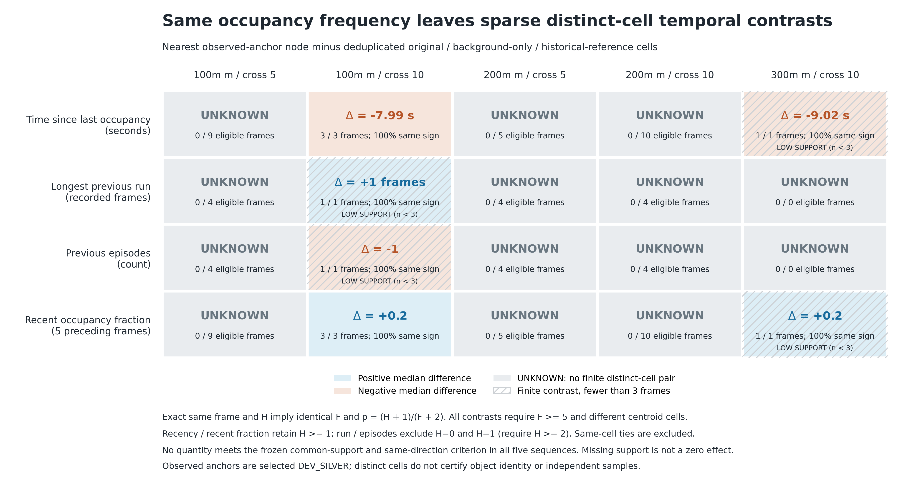
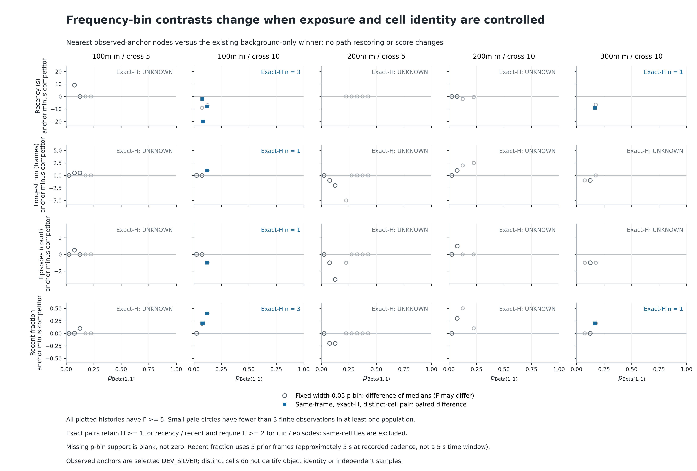

# FMCW Occupancy Temporal-Structure Audit

2026-10-13。**IMPLEMENTED / TESTED / VERIFIED RESULT：冻结历史的描述性条件比较；机制 SPECULATIVE；检测效用 UNKNOWN。**

**严格 kill criterion 已触发：E18 occupancy is sufficient at the current evidence level；不提出 E21 background model。** 四个时间结构量中，没有一个在全部五序列都具备非退化、同帧同频率的共同支持并呈稳定方向。局部差异存在：100m_cross_10 有3帧，300 m 仅1帧。这个停止结论表示当前证据不支持增加模型，**不是证明 p 数学上包含全部时间信息，也不是把缺支持写成零效应**。

没有修改 E18、node term、score、权重、门限、graph、labels、calibration、offset、旧结果或图；没有 classifier、regression、window search、feature combinations、路径重评分或新 DP。全部新文件在 [results/occupancy_temporal_structure_audit](results/occupancy_temporal_structure_audit/README.md)。

## 1. 冻结输入与本轮执行顺序

只读已完成 scene audit 的 **fine_1m** causal cell-history events 和 node statistics。它正是 E18 历史源：既有 post-ROI/intensity/leveled-height 的 fine-cache 全场景占用，不是只用 path/anchor nodes 重建背景，也不是 full raw scene。此次不读 raw bags，不重新生成候选/地图，不读取 GNSS 定义特征。

采用已有五包 **272帧、20,122 fine pregeometry nodes**；历史 persistent-clutter references 属于另一既有 graph，因此同样给该 graph 的全部 **16,995 nodes** 查询冻结 fine_1m 历史。共 **37,117 node records**，所有 H 和 E18 p 精确复现。位置仍为分析坐标 `[sensor_x,sensor_z,-sensor_y]`；时间只用 bag-record time，不用陈旧 ROS header。

规则冻结 **15:04:49.863 UTC**；全节点特征完成 **15:05:39.743 UTC**、计算耗时 **3.789 s**；事后 join 从 **15:08:41.416 UTC** 开始。原 scene receipt 早于其原 anchor/path join，本轮近期窗也先对全部 nodes 算完并保存 [TEMPORAL_FEATURES_COMPLETE.json](results/occupancy_temporal_structure_audit/TEMPORAL_FEATURES_COMPLETE.json)，之后才读取旧匹配 IDs 和已保存路径。

已有历史报告与结果在此前任务中已知，故**不是 blind / held-out preregistration**。本轮新 window、bins、量的定义、共同支持条件和 kill rule 在产生新时间结构对比之前固定。近期窗是对原不可变、pre-join cell-event 表的确定性查询，原 scene audit 没有直接存这一列；没有为它引入新的点、ROI、标签或模型。

## 2. 仅五个可解释量

| Quantity | 冻结定义 | UNKNOWN / 退化边界 |
|---|---|---|
| p_beta11 / frequency | 原 centroid cell 的 `p=(H+1)/(F+2)`；同时保留 H/F | F=0 的 p=.5 是 prior，H/F UNKNOWN，不作经验 frequency bin |
| Time since last occupancy | 当前 bag time 减最后一个过去占用帧的 bag time | H=0 时 UNKNOWN，不填0或∞ |
| Longest previous run | 该 cell 在过去帧中最长连续 occupied-frame run | F=0 UNKNOWN；F>0且H=0为已知0；H=1必为1 |
| Previous episodes | 过去被至少一个未占用记录帧隔开的 occupied episodes 数 | F=0 UNKNOWN；F>0且H=0为已知0；H=1必为1 |
| Fixed recent fraction | **前5帧 f−5…f−1 的 cell hits / 5** | F<5 UNKNOWN；不包含当前帧，不补 pre-bag history |

只有最后一行是新增派生列，其余与原 frozen scene statistics 逐值一致，F=0 的结构值按本轮规定改为 UNKNOWN。Run/episode 是 cell 的采样历史，**不是 path 连续出现或同一物体持续存在**。不同物体、同一表面的扫描落点均可能占用同一个 cell。

**近期窗选择依据 cadence，未看新对比表现**：[acquisition_cadence.csv](results/occupancy_temporal_structure_audit/acquisition_cadence.csv) 的五包 median Δt 为0.99856–1.00081 s。5 acquisition frames 表示约5 s的短历史；只计算这一种长度，没有其它窗口敏感性/优化。实际 `t_f−t_(f−5)` 的全 cohort 范围 **4.005–5.043 s**，200m_cross_5 的较短窗来自其既有非均匀间隔；其余包约4.97–5.04 s。每行保留实际时间跨度，绝不把5帧描述成精确5 s。

## 3. 主条件比较及停止规则

**主比较：同 sequence、同 frame、exact H。** 因此 F、H/F、p及原 `b=1−2p` 完全相同；任何差异都不是重新发现 anchor 的较低占用。所有同 cell 配对记录为 deterministic ties，不能充当独立区分证据；不同 cell 也不认证为不同物体或 negative。

辅助 p bins 提前固定为宽度 **0.05**，`[0,.05)…[.95,1]`，报告每 bin 的 finite n、frame index、H及 median/IQR，分 all F≥1、warm F≥5、固定 chronological thirds。Bin 内跨帧仍可能混合 F/H，所以不能仅凭 bin 差异宣布增量信息。主判定不读取这些 bin contrasts。

比较 populations：84个全部 observed-anchor-matched fine nodes；80个 nearest matched nodes作为一 observation 一权重的主配对；原 fixed silver feasibility witnesses；原 original/background-only/joint E18 unconditional winners；历史 persistent-clutter reference paths。Witness 和 E18 经常与 anchors 同 cell，绝不把它们当独立对照；历史 reference 名称沿用旧证据，不认证 clutter 身份。

**冻结 kill rule**，见 [protocol](results/occupancy_temporal_structure_audit/protocol.json)：一个单独 quantity 必须在五序列各自均满足：

1. F≥5；至少3个 finite、same-frame exact-H、不同 centroid-cell 的 observed-frame 对比。
2. Recency/recent fraction 要 H≥1；run/episodes 要 H≥2，排除 H0/H1 的结构退化。
3. 每帧用 original/background-only/historical-reference 的同H control cells，去重后取 control median，observed frames 等权，避免长 path 重复权重。
4. 每包非零 median 差同一方向，且每包至少2/3 paired frames 同方向；可以全正或全负，但不组合 quantity、不选窗口/分箱。

3帧是预先固定的最低描述性支持条件，不是独立样本数、统计功效证明或 detector threshold。任一条不满足，就按用户要求停止 E21 方向。缺共同支持是 **UNKNOWN**，不是0 difference。

## 4. A：窄 frequency bins 与同帧 exact frequency 的结果

辅助 `[0.05,0.10)` bin、F≥5、nearest anchor−background-only 的差异如下。n列是run/episodes/recent使用的anchor/control节点数；recency finite n 更少，完整表保留。

| Sequence | n anchor / control | Recency median差（s） | Run median差 | Episodes median差 | Recent fraction median差 |
|---|---:|---:|---:|---:|---:|
| 100m_cross_5 | 6/10 | +8.997 | +0.5 | +0.5 | 0.0 |
| 100m_cross_10 | 3/14 | −9.020 | 0.0 | 0.0 | +0.2 |
| 200m_cross_5 | 6/16 | UNKNOWN | −1.0 | −1.0 | −0.2 |
| 200m_cross_10 | 4/13 | −0.002 | +1.0 | +1.0 | +0.3 |
| 300m_cross_10 | 1/15 | UNKNOWN | −1.0 | −1.0 | 0.0 |

没有统一方向；300 m此bin只有一个anchor，不能当稳定效果。更重要的是这些是**不同帧的同bin populations**，H/F和曝光不完全相同。独立核验发现126个 warm comparison bins 混合了F/H；它们未进入主 kill 判定，完整 [bin distributions](results/occupancy_temporal_structure_audit/frequency_bin_distributions.csv)、[bin support](results/occupancy_temporal_structure_audit/frequency_bin_support.csv)、[bin contrasts](results/occupancy_temporal_structure_audit/frequency_bin_contrasts.csv) 均保留。

**主同帧 exact-H，distinct-cell、F≥5、非退化的 comparator-pool 结果**：表中 `n / median Δ`，Δ=nearest anchor−每帧deduplicated control median。

| Sequence | Recency（s） | Longest run（frames） | Episodes | Recent fraction |
|---|---:|---:|---:|---:|
| 100m_cross_5 | 0 / UNKNOWN | 0 / UNKNOWN | 0 / UNKNOWN | 0 / UNKNOWN |
| 100m_cross_10 | 3 / −7.986 | 1 / +1 | 1 / −1 | 3 / +0.2 |
| 200m_cross_5 | 0 / UNKNOWN | 0 / UNKNOWN | 0 / UNKNOWN | 0 / UNKNOWN |
| 200m_cross_10 | 0 / UNKNOWN | 0 / UNKNOWN | 0 / UNKNOWN | 0 / UNKNOWN |
| 300m_cross_10 | 1 / −9.020 | 0 / UNKNOWN | 0 / UNKNOWN | 1 / +0.2 |

100m_cross_10 的recency和recent在本包最低支持条件下通过；每个quantity的五包整体条件均失败。Run/episodes只一帧有非退化差异。不能把其余三包写成“时间结构不不同”，因为可比较的独立同频率位置缺失。

**全部指定 population 的共同支持解释**：固定 silver witnesses 与nearest anchors在所有warm同H帧均同cell（19/11/17/18/5）；joint E18逐包warm同H帧为19/11/16/18/5，其中samecell为18/11/16/18/5，顺序均按本报告五序列。Original/background-only在100m_cross_5和两个200 m序列多已选到同cell evidence，其ties不是negative discrimination；200m_cross_5仍有少量不同cell的H0 ties。历史五条 persistent reference 在anchor同帧 **F≥1时没有 exact-H共同支持**；200m_cross_5与300m_cross_10各自frame0的H0/F0巧合只有prior，结构量均UNKNOWN，不构成经验共同支持。因此低frequency anchor对高frequency reference的无条件run差不能叫增量。逐群组、每quantity、cold/warm/不同cell/非退化的支持与差异都在 [exact_frequency_contrast_summary.csv](results/occupancy_temporal_structure_audit/exact_frequency_contrast_summary.csv)。

## 5. B/C：跨 nominal ranges，以及两个 occupancy-only failure cases

两个已有 background-only 非银标 winner cases 的局部差异如下。所有行使用相同 H、F与p；读取原 saved paths，**没有重新选择、评分或运行路径**。

| Sequence/frame | H / F / p | Recency anchor / BG-only（s） | Run anchor / BG-only | Episodes anchor / BG-only | Recent anchor / BG-only |
|---|---|---:|---:|---:|---:|
| 100m_cross_10/22 | 1 /22 /0.08333 | 0.978 /20.987 | 1 /1 | 1 /1 | 0.2 /0.0 |
| 100m_cross_10/23 | 2 /23 /0.12000 | 0.995 /8.982 | 2 /1 | 1 /2 | 0.4 /0.0 |
| 100m_cross_10/24 | 1 /24 /0.07692 | 3.981 /6.004 | 1 /1 | 1 /1 | 0.2 /0.0 |
| 300m_cross_10/10 | 1 /10 /0.16667 | 1.001 /10.021 | 1 /1 | 1 /1 | 0.2 /0.0 |

这四帧说明：历史 hit相同但排列不同，anchor-associated cell 的过去占用在这些局部比较里更近、更集中。100 m3/3 recency负、recent正；300 m只有1帧。多数其它H0同频率帧的run/episodes/recent皆0且recency未知，不能通过时间顺序解释它们的排序。

**B：跨100/200/300 m稳定性未建立。** 两个失败包的局部recency/recent方向相同；100m_cross_5与两个200 m包没有该主对照的非退化共同支持，辅助bin也出现反向。不能按range池化补齐五包证据；这些是同一研究场景的selected DEV observations。

**C：不能说这些量解释了 joint E18 的成功。** 原 joint E18选取的cell常与anchor相同，局部recency/recent可与局部时间相邻占用兼容，但E18现有joint使用的是原background+motion，不使用这些新列。本轮未重评分、干预term或求解DP，不能证明若加recency便会翻转winner，也不能用4帧解释整条完整bag路径的累计竞争。Case证据只是机制提示。

## 6. D：数值非冗余与检测增量是两件事

在全fine节点内部，固定frame与H的strata中仍存在时间结构展开。下表为F≥5、非退化H、至少两个finite节点的strata，“非零range strata / 可比较strata”。它不使用anchors，显示时间排列不能一般地由p恢复。

| Sequence | Recency | Run（H≥2） | Episodes（H≥2） | Recent（H≥1） |
|---|---:|---:|---:|---:|
| 100m_cross_5 | 216/342 | 235/318 | 226/318 | 262/342 |
| 100m_cross_10 | 355/549 | 387/509 | 348/509 | 405/549 |
| 200m_cross_5 | 638/1069 | 751/1010 | 673/1010 | 698/1069 |
| 200m_cross_10 | 399/605 | 424/565 | 409/565 | 451/605 |
| 300m_cross_10 | 505/773 | 543/726 | 486/726 | 516/773 |

同H/F的最大recency range为 **24.0–70.0 s**，run为 **12–36 frames**，episodes **5–10**，recent为 **0.8–1.0**。所以这些quantity**不是 E18 p或node background term `1−2p` 的确定函数**；没有检验相对于完整原node的geometry/support项的独立预测效用。H0/H1时run/episodes退化，不能用同一表混合推广。完整 [same-frame H structure spread](results/occupancy_temporal_structure_audit/all_fine_same_frame_H_structure_spread.csv) 与 [global reference associations](results/occupancy_temporal_structure_audit/global_reference_associations.csv) 保留；global correlation只作背景描述，不是incremental检验。

数值非冗余不等于稳定区分类别：selected anchors、prior-cell混合身份、预筛选、相同场景和时间相关均限制解释。因此主杀停结论与这张展开表并不矛盾。

## 7. E：Duration、cold start、frame index 的影响

- Anchor主observations时间范围不一致：两条100 m从frame11/18开始，200m_cross_10从frame30开始；200m_cross_5和300 m从frame0开始。Nearest anchor样本跨度约20.0/13.0/21.0/17.0/10.0 s，background-only完整路径约31.0/45.0/80.0/47.0/62.0 s。Whole-path的run/episodes差天然混合不同历史曝光与F，不作为增量证据。
- 80个nearest anchors里 **2个F=0** 的run/episodes/recency均UNKNOWN；**10个F<5** 的recent fraction UNKNOWN。H0、F>0的run/episodes=0是已知过去记录中无占用，不是cold-start imputation；recency仍UNKNOWN。
- 主对比固定同帧、同H，并按F≥5单列，排除了这部分路径长度/frame index/cold-start差异；100m_cross_10那3帧的局部现象不会由不同F直接产生。但它们是相邻的22–24帧，不能当3个独立飞行重复；只有一段局部事件。
- Cold-start去除后，300 m仅剩很少observed支持；不偷偷保留不足5帧的完整window比例、不把没有hit的age设0。固定chronological thirds的bin统计没有形成跨五包稳定结果，也未用于选择更有利时段。

## 8. 输出、独立验证与结论

可复现命令、schema和输入hash见 [README](results/occupancy_temporal_structure_audit/README.md)。Python3.10.12、NumPy2.2.6；freeze parent `cb0c2a9298c30d8eb1868f96c9dd2acf7fe030b0`。所有分析确定性，无安装/随机抽样。新report/results尚未commit/push；不包含bag、PCD或ROS文件。

**TESTED**：[independent temporal validation](results/occupancy_temporal_structure_audit/validation.json) 的8项synthetic tests覆盖手算occupancy、空帧、首次访问、H0/H1、当前帧排除、5帧window、future-prefix invariance、逐包reset等；独立binary-prefix/strict-left查询核验37,117nodes与148,656个原fine1m occupied-cell records；**437 protected files、18 frozen compute inputs哈希未变**。E18 p以及原recency/run/episodes除声明的F0 UNKNOWN外精确一致。

[独立条件检验](results/occupancy_temporal_structure_audit/independent_conditioning_audit.json) 精确复核 **1,600 pair rows、320 kill-frame rows、20 sequence summaries**与kill decision；同cell去除、control-cell去重、exactH/F、F≥5、H≥1/2和UNKNOWN均正确。没有重新运行paths。0.05-bin的跨F/H差异未进入主判定。

最终判定由 [kill_decision.json](results/occupancy_temporal_structure_audit/kill_decision.json) 固定规则直接产生：**没有单一quantity通过五包稳定条件；当前证据层面 E18 occupancy 足够，不提出 E21 background model。** 这里的“足够”是当前研究决策的证据门槛；数学时间信息确实可能超出frequency，而其稳定、可用的任务增量仍UNKNOWN。保留局部正现象、辅助反向、结构性ties、共同支持不足与冷启动缺失，不通过重选population/window/bin来挽救方向。

## Observed result -> mechanism interpretation -> alternative explanation -> whether E21 is justified -> held-out falsification requirement

**Observed result：** 同H/F的时间排列数值不冗余；局部100 m三帧、300 m一帧更近的recency/更高recent fraction，但无五包稳定共同支持。**→ Mechanism interpretation：** cell历史计数无法表达hit的时间排列，局部近期重访可能伴随移动或缓慢通过的return evidence。**→ Alternative explanation：** 同表面采样/不同对象占同cell、DEV anchor选择、路径时段与co-association、预筛选和早期历史不足；少数相邻帧不是独立重复。**→ Whether E21 is justified：否；按冻结strict kill criterion，保留E18，不提出E21 background model或新score。**→ Held-out falsification requirement：** 独立身份/presence、occupied dynamic clutter、target-absent、moving→hover/revisit与不同scene/date数据；保持相同5帧window和frequency-conditioned比较，事先确保各序列同H/F的非退化共同支持。若方向反转、仅由F/曝光造成或只在selected anchors成立，应否定稳定时间结构增量，而非再调窗口/组合。
