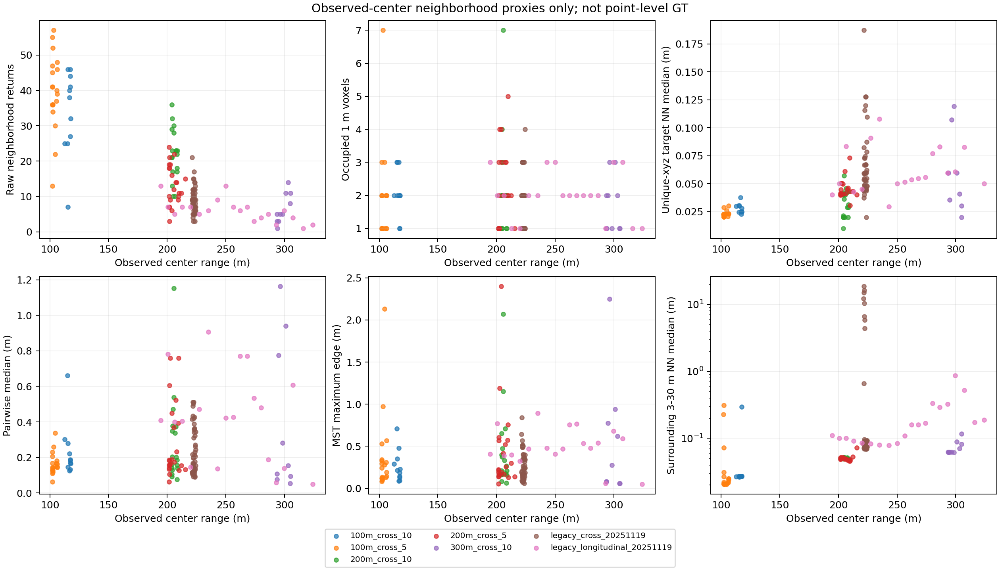
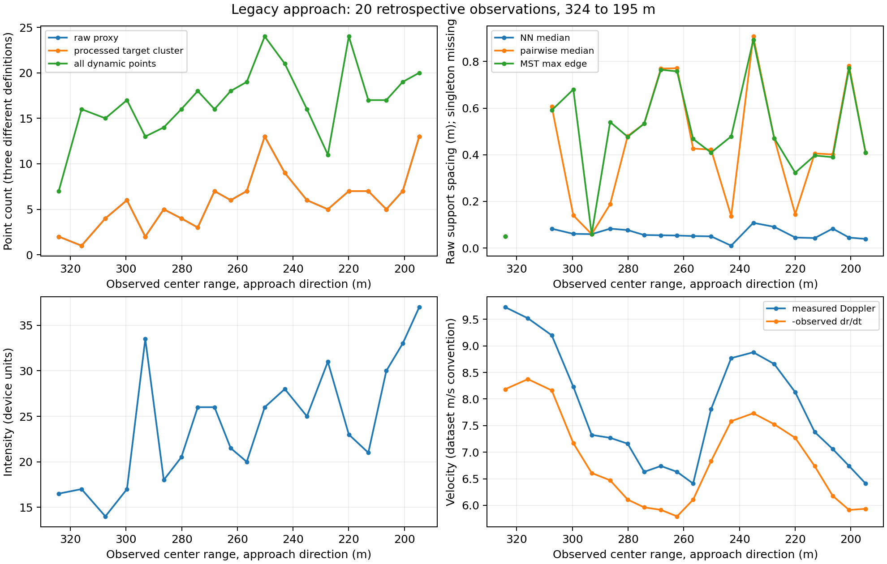

# FMCW-LiDAR Range–Sparsity Audit

## 结论与边界

日期：**2026-10-10（Asia/Shanghai）**。状态：**TESTED / VERIFIED RESULT，仅描述性 DEV/pseudo 诊断，不是独立 GT 或算法性能结论**。

本轮没有运行或修改 detector/tracker，没有改变 labels、背景过滤、DBSCAN、DP、Doppler 门限或权重。只读取原始 ZIP/bag、raw PCD 和已有观测中心，生成统计、CSV 和诊断图。

**A. 点数是否稳定随距离下降而增加？** 有总体趋势，但**不稳定、不单调**。同日期横飞100/200/300 m的raw邻域点数中位数为 **39.5/17.5/5**；历史纵向 **324.18→194.67 m** 的range–count描述性rho为 **−0.695**，但19个接近区间中只有9次增点、9次减点、1次持平。距离不是每帧点数的确定函数。

**B. spacing是否支持增大epsilon？** **有限、分指标的支持**，不是充分依据。去除重合xyz后，NN中位数随100/200/300 m为 **0.023/0.040/0.060 m**，符合较远处局部采样较稀的描述；但raw NN、pairwise spacing、extent和MST连通瓶颈并不一致单调增长。不能据此规定epsilon函数或证明adaptive DBSCAN有效。

**C. clutter是否也变稀，存在merge风险？** 固定3–30 m周边球壳的raw NN中位数为 **0.027/0.050/0.062 m**，纵向range–clutter-NN rho为 **+0.755**，间距变化不是target独有属性。扩大连接尺度也影响背景；**真实target–clutter merge概率为UNKNOWN**，本轮没有点级negative GT或聚类/扫参实验。3–15 m球壳在远距离常为空，不能只看其有点帧。

**D. 当前更支持哪种adaptation？** 最直接支持**稀疏support/表示依赖的最小点数问题**，以及保留弱点使用时间上下文的动机；对仅按range扩大epsilon的支持较弱。不能确定adaptive minPts，也不能宣称adaptive window优于fixed。上一轮soft adaptive-window和冻结DP的负结果仍有效；本轮不设计新方法、不选择参数。

## 1. Material Passport / 数据证据等级

- 来源：原始数据复读 + 已有冻结/历史观测中心，不是新detector输出。
- 标签：2026-02-05五条closure-passing横飞为 **DEV_SILVER**；2025-11-19两条为 **RETROSPECTIVE_TARGET_LIKE_NOT_EXTERNAL_GT**。均不是独立点级/论文GT。
- centers保留原值，无重新定位、插值、外推；未标注帧不视作无返回或负样本。
- range为sensor-relative `norm(observed center)`，不是目录距离或GNSS插值。使用原始 `[x,z,-y]` 转轴；不以provisional ENU translation改变sensor range，不继续calibration closure。
- 旧 `81-82` PCD的具体设备/topic及是否融合两个sensor：**UNKNOWN**；旧文件名绝对epoch与采集日期一致性：**UNKNOWN**。只使用现有坐标和完整文件名的相对时间。
- 基础Git revision：`feb9eda4009a5795ca02e0a3aaac5b8fafcfb1a2`。
- 执行脚本SHA-256：`d7e5f34e3e2f0d85f603a70e29d5d9e9dae6c4aa5c30b3f1864d8bd6aa9902d4`。
- 冻结诊断协议SHA-256：`32be7ef26911cf7570783abe712f519fb1c695b4154c70e268a56742f048df9b`。
- 冻结DEV labels SHA-256仍为 `37c4452a68e544d75034389f82bbaf1e868903bb2225b395b9d66d0cdd48b8db`。
- 73个raw输入的SHA、三个标签文件的SHA、环境、命令、输出SHA见 [run_manifest.json](results/range_sparsity_audit/run_manifest.json)。

| 序列 | 观测n | 实际center range / m | 标签来源 |
|---|---:|---:|---|
| `100m_cross_5` | 19 | 102.06–106.37 | 冻结DEV_SILVER |
| `100m_cross_10` | 11 | 112.70–117.61 | 冻结DEV_SILVER |
| `200m_cross_5` | 22 | 201.70–215.59 | 冻结DEV_SILVER |
| `200m_cross_10` | 18 | 204.10–208.70 | 冻结DEV_SILVER |
| `300m_cross_10` | 10 | 293.60–305.14 | 冻结DEV_SILVER |
| `legacy_cross_20251119` | 48 | 221.38–224.27 | 历史baseline ID1实测关联 |
| `legacy_longitudinal_20251119` | 20 | 324.18→194.67 | 历史baseline ID3实测关联 |

合计 **148个观测、444个半径行、2,434个3 m邻域raw returns**。100/200/300 m主比较只使用同日期的80个DEV观测，旧两条序列分层，不跨日期池化。

旧横飞frames28/30/47/50是prediction-only，排除。`300m_roundtrip_10`虽有长去/回程likely-UAV LiDAR trajectories，但Doppler closure未通过，不升级为与五条PASS横飞同等级labels，也不纳入主raw统计。其他未确认/失败工况、旧插值型300 m pseudo labels排除。因此纵向趋势的独立重复验证仍为 **UNKNOWN**。

## 2. 冻结统计口径

[protocol.json](results/range_sparsity_audit/protocol.json) 在首次raw统计前冻结。这些是诊断定义，不是detector调参。

1. **Raw target-neighborhood proxy**：原始有限、非全零xyz，距已有center≤3 m，保持现有DEV survival兼容；0.5/1 m嵌套球完整保留作敏感性。无逐点身份GT，邻域点不等于每一点都已确认UAV。
2. target主统计不先做intensity/height/background/neighborhood/DBSCAN；另记录既有 `10≤intensity≤250` 子集。
3. **Occupied voxels**：固定sensor-frame原点 `[0,0,0]`，`floor(xyz/s)`，`s=0.04 m/1 m`；只是表示诊断。计数依赖grid平移/转轴，raw count不等同于minPts所见voxel count。
4. **Extent**：xyz span、pairwise最大距离（diameter）、range thickness。singleton的span/diameter=0只是观测支撑范围下界，不是UAV物理尺寸。
5. **Spacing**：raw NN、去除完全相同xyz后的unique-NN、不同raw point indices的无序点对pairwise距离（保留coincident xyz的零距离，非unique-xyz pairwise），逐帧计算q25/median/q75，再按帧汇总，避免高点数帧支配pooled统计。singleton spacing为 **UNKNOWN**，numeric CSV留空，不填0。
6. **Connectivity**：unique-xyz Euclidean MST最大边，描述minPts=1连接瓶颈，不用于选epsilon；NN小不能保证全部returns连通。2000点以上不算pairwise/MST，本轮未触发。
7. **Clutter proxy**：3–15 m和3–30 m周边球壳，分别统计raw与既有intensity子集，两个窗口都报告；它们是未标注返回，不是可靠negative labels。
8. Density=`N/[4π/3*(R_outer³−3³)]`，未校正FOV/beam/遮挡/表面几何，称球壳采样密度，不是均匀物理体密度。空壳density=0；少于2点的NN为UNKNOWN。
9. gap为target邻域点到center 3 m球外返回的最短距离，受排除球影响，不是已标注target–clutter间距。
10. intensity保留设备数值，物理辐射标定 **UNKNOWN**。Doppler保留原 `velocity` 符号；另给 `-median(velocity)-observed dr/dt`，符号来自已有数据证据，不是通用sensor specification。
11. 真dt来自bag record time或完整PCD文件名；Feb observed dt约0.970–3.002 s，旧纵向约1.000006–1.000034 s。center有限差分包含缺帧跨度及单边端点，不是瞬时GNSS速度真值。
12. actual range固定25 m bins；nominal组和逐序列同时汇总。仅报描述性Spearman rho，不报p值/显著性，不把相邻帧当独立样本。

## 3. 横飞100/200/300 m：点数和微结构

下表为**各帧统计的组中位数**，3 m主口径。

| Nominal组 | n | Raw count [IQR] | 4 cm voxels | 1 m voxels | Raw NN / m | Unique NN / m | Pairwise median / m | MST最大边 / m | Raw diameter / m |
|---|---:|---:|---:|---:|---:|---:|---:|---:|---:|
| 100 m | 30 | 39.5 [32.5,45.75] | 27.5 | 2 | 0.0229 | 0.0230 | 0.1659 | 0.2237 | 0.5244 |
| 200 m | 40 | 17.5 [10.75,22.25] | 14 | 2 | 0.0400 | 0.0404 | 0.1838 | 0.2199 | 0.4673 |
| 300 m | 10 | 5 [3.5,10.25] | 5 | 1.5 | 0.0356 | 0.0595 | 0.1547 | 0.2781 | 0.2924 |

Spacing/MST有效分母为30/30、40/40、9/10；300 m余下1帧是真正raw singleton。148个3 m观测共141个重合坐标额外返回，仍计raw count，但另给unique-NN；远距低点数时两种NN差别不能忽略。

| 序列 | Raw median（min–max） | 1 m voxel median | Diameter / m | Raw NN / m | Intensity median | Measured Doppler median / m/s |
|---|---:|---:|---:|---:|---:|---:|
| `100m_cross_5` | 40（13–57） | 1 | 0.543 | 0.0207 | 41.5 | 0.000 |
| `100m_cross_10` | 38（7–46） | 2 | 0.491 | 0.0248 | 38 | −0.015 |
| `200m_cross_5` | 13（3–24） | 2 | 0.443 | 0.0411 | 29.5 | −0.1475 |
| `200m_cross_10` | 22.5（10–36） | 2 | 0.479 | 0.0200 | 30.25 | −0.170 |
| `300m_cross_10` | 5（1–14） | 1.5 | 0.292 | 0.0356 | 23.5 | −1.600 |

**VERIFIED RESULT：**远处raw support总体少、4 cm occupied count也下降；但1 m表示把近距几十个returns压成1–2 cells。300 m有5/10帧为1 m voxel singleton，只有1/10帧为raw singleton，不能混为同一种sensor non-return。

1 m voxel singleton分别为100 m **12/30**、200 m **14/40**、300 m **5/10**；occupied cells<3为 **24/30、29/40、8/10**，共61/80。近处也会被粗voxel化压低support，range不是唯一控制量。

unique-NN组间增长是真实描述性信号，但MST100→200 m未增长，pairwise/extent也非同方向。以固定角采样解释它只是 **SPECULATIVE physical interpretation**：角分辨率、scan pattern、beam footprint、目标姿态、设置和多返回机制均 **UNKNOWN**；没有验证 `N∝1/r²` 或 `epsilon∝r`。

三组frame-median intensity中位数为40.25/30/23.5，近强远弱是选集描述，不是反射率标定或UAV特异性。Doppler中位数0/−0.17/−1.60 m/s，IQR分别[−0.315,0.2525]/[−1.394,0.188]/[−3.769,−0.427]；飞行方向/阶段混杂，不能写成range规律。



## 4. 纵向接近：总体增点，不是逐帧稳定规律

20个既有观测的raw1 m与3 m counts完全相同，也逐帧等于旧processed target cluster；没有为了趋势好看改center。

`2,1,4,6,2,5,4,3,7,6,7,13,9,6,5,7,7,5,7,13`

- range：324.175→194.668 m，19个interval全部接近。
- Raw：median6、mean5.95、min–max1–13、合计119；前5帧mean3.0、后5帧mean7.8，不是3→18。
- 相邻count变化：9增/9减/1平，局部起伏强。
- 4 cm voxel median5、1 m median2；raw增点不稳定转化成1 m voxel增点。
- Diameter median0.575 m；xyz span median[0.424,0.354,0.187] m；range thickness median0.430 m。
- frame-median intensity中位数24 [19.5,28.5]；measured Doppler中位数+7.353 [6.740,8.688] m/s。这是帧级汇总，不是旧报告的point-pooled median。

| 与actual range的描述性rho | rho | 有效n |
|---|---:|---:|
| Raw count | −0.695 | 20 |
| 4 cm / 1 m occupied count | −0.579 / −0.135 | 20 / 20 |
| Raw / unique NN median | +0.325 / +0.277 | 19 / 19 |
| Pairwise median / MST最大边 | −0.221 / +0.063 | 19 / 19 |
| Raw diameter | −0.198 | 20 |
| Intensity median / Doppler median | −0.690 / +0.418 | 20 / 20 |
| 3–30 m clutter density / NN | −0.486 / +0.755 | 20 / 20 |

固定25 m bins的raw median，远→近：300–325 m **2（n3）**；275–300 m **4.5（n4）**；250–275 m **7（n5）**；225–250 m **6（n3）**；200–225 m **7（n4）**；175–200 m **13（n1）**。最后一格仅1帧，不是稳定近距平台。

count方向比spacing/连通瓶颈更强；NN弱正相关不能替代MST近零相关。时间、姿态、速度与range同时变，不能做纯range因果推断。



## 5. 周围clutter：也变稀，强依赖场景与窗口

| Feb nominal组 | 3–30 m点数median | Sampling density / points·m⁻³ | Raw NN / m | NN有效帧 |
|---|---:|---:|---:|---:|
| 100 m | 33,625.5 | 0.2976 | 0.0265 | 30/30 |
| 200 m | 15,468 | 0.1369 | 0.0500 | 40/40 |
| 300 m | 4,563 | 0.0404 | 0.0623 | 10/10 |

固定较大球壳中background采样也变稀、NN增大，不能把间距变化作target专属属性。纵向rho=+0.755，但球壳count不是单调函数：约307/300 m仅17/11点，约243/235 m为7,406/7,450点，表面几何/遮挡/视角混杂强，不能标定普遍密度律。

3–15 m NN为0.0440/0.0636/0.0587 m，但只在 **17/30、31/40、3/10**帧可算；空壳10/30、8/40、7/10。纵向小壳18/20为空，NN仅1/20可算，其18.49 m单帧值**不代表稳定clutter spacing**。

球外nearest-return gap的组median为8.48/10.46/15.93 m，7序列最小约3.084 m；受固定排除球和已选择isolated observations制约，不能证明普遍不merge。target unique-NN与clutter raw-NN在相近厘米量级，但去重口径不同，只作粗描述。是否发生target-background/clutter-clutter合并及频率均 **UNKNOWN**，本轮没有聚类扫参。

## 6. “接近时3→18点”的来源复核

原话准确出处、帧区间和统计定义：**UNKNOWN**。现存纵向报告/CSV和本轮raw复读不能支持它作为target-count结果。

| 量 | 来源/定义 | 核实值 |
|---|---|---:|
| Raw target-neighborhood points | 固定旧center，1/3 m raw球 | 1–13，合计119 |
| Processed target-cluster points | 旧 `n_points`，已过intensity/height/background/neighborhood | 1–13，合计119 |
| Whole-frame dynamic points | 旧 `dynamic_points`，包括其他残余点 | 7–24，合计338 |
| Broad ROI raw points | 固定sensor ROI：x8–510、y±200、z±60 m | frame15为272,875 |
| Organized samples | raw PCD header，含zero placeholders | 每帧1,250,000 |

**可核实潜在混淆例子：**旧CSV第9行/filtered f15，`n_points=3`、`dynamic_points=18`；本轮raw邻域也是3，ROI272,875。f17是target6/dynamic18。证明同文件有“3”和“18”的不同量，**不能证明旧说法来自该行**。

旧纵向raw30帧、filtered28帧，filtered缺raw首两帧。按filtered文件名去前缀精确匹配：f8→`1649361783.700961000.pcd`，f27→`1649361802.701372000.pcd`。旧CSV time截整数，本轮保留小数。raw header点数后的3889字节零padding记录而不读成点；字段按名读：raw `x y z intensity velocity`，filtered `x y z velocity intensity`。

旧横飞48个实测帧raw1 m=3 m、共432点；processed目标419点。13点差额中5点由intensity解释，f29的2点与f59的6点由已有pseudo-stage CSV的neighborhood删除解释。旧3–17是**processed cluster**范围，本轮raw为3–21，不能拼成同一range趋势。

逐项出处及UNKNOWN保存在 [count_claim_provenance.csv](results/range_sparsity_audit/count_claim_provenance.csv)。

## 7. Adaptive processing的证据判断

| 选项 | 直接支持部分 | 尚不支持部分 |
|---|---|---|
| Adaptive epsilon | unique-NN组间增大，纵向unique-NN弱正相关 | 稳定全目标连接range律、最优epsilon、算法收益；raw与voxel输入等价 |
| Adaptive minPts | 远处raw/4 cm support下降；粗voxel产生大量1–2 cell目标 | 只靠range选minPts；降低minPts后能控制clutter/false alarms |
| Adaptive temporal integration | 极少点、单点、强逐帧起伏使单帧support不可靠；既有时间连续性 | 更长远距window必然更好、adaptive胜fixed、累积已解决clutter排序 |

物理/观测层面最强的是**support衰减和representation-dependent sparsity**，其次是unique-NN趋势，最弱的是range增加必然要求更大连接epsilon。更支持保持稀疏support可用、把时间上下文作为待验证证据，而不是仅扩大空间半径。这不是新算法方案或参数授权；adaptive minPts/window的相对效益仍 **UNKNOWN**。

已有 [Temporal MVP](FMCW_Temporal_Evidence_MVP.md) 正式fixed/adaptive/adaptive+Doppler结果7/7/8 of80，以及 [DP MVP](FMCW_Published_Baseline_and_DP_TBD_MVP.md) 的0/80 persistent-clutter失败保留。稀疏现象不等于已验证累积收益。

## 8. 敏感性、偏差和UNKNOWN

- Feb **6/80帧**在1→3 m时增加点；可能是target extent、center误差或clutter，身份 **UNKNOWN**。组中位数基本不变（200 m raw17→17.5），但MST长尾敏感：3 m球100/200/300组最大值2.133/2.401/2.248 m，1 m球0.711/1.151/1.157 m；不能全部解释成UAV内部spacing。
- 0.5 m球会截去部分return，完整保留，不据结果缩球、重center或改labels。旧横飞/纵向1与3 m计数一致仍不替代点GT。
- 仅选择已有observed轨迹，遗漏弱帧/不可见帧，未观察帧的target计数与零返回率 **UNKNOWN**。
- 五条Feb序列内部range-count rho为约−0.007/+0.370/−0.113/−0.215/+0.778（100_5/100_10/200_5/200_10/300_10）；最后一条甚至稍远点数更多。aggregate趋势不能当逐帧规律。
- 组间speed/aspect/flight phase/scene混杂，只有一个300 m工况，一个历史纵向；不由相邻帧构造独立样本显著性。
- 角分辨率、beam覆盖、range噪声、UAV姿态/反射面、sensor设置、旧双sensor身份、可靠negative/clutter labels均 **UNKNOWN**。
- 按`academic-research-suite`完成11/11统计解释风险检查：分层防聚合反转误读；不作生态/总体外推；揭示selection/Berkson、collider和survivorship偏差；不报缺base-rate的operational precision；不挑极端前后点制造改善；全报预定义指标防look-elsewhere；冻结口径/保留半径防forking paths；不把correlation/time-range共变写成因果。整体等级 **CAUTION**。

## 9. 可复现性和交付

环境Python3.10.12、NumPy2.2.6、SciPy1.15.3、Linux；raw统计 **2026-10-10 00:00:07–00:05:52 +08:00**，无随机步骤。

```bash
PYTHONDONTWRITEBYTECODE=1 fmcw/bin/python -m unittest discover -s tests -p test_range_sparsity_audit.py -v
PYTHONDONTWRITEBYTECODE=1 fmcw/bin/python scripts/range_sparsity_audit.py --phase freeze
PYTHONDONTWRITEBYTECODE=1 fmcw/bin/python scripts/range_sparsity_audit.py --phase audit
PYTHONDONTWRITEBYTECODE=1 MPLCONFIGDIR=/tmp/fmcw_range_sparsity_mpl fmcw/bin/python scripts/plot_range_sparsity_audit.py
```

**验证：**4个synthetic tests通过；80/80 DEV raw计数与旧3 m survival完全一致；68个旧观测被独立raw读取核查；第二审查从saved point CSV独立重建444行counts/voxel/NN/pairwise、用Prim复算MST、复算summary/rho，全部一致；39个protected code/labels/protocol文件before/after SHA相同。

执行脚本未触发的两项边界情况明确保留：恰好3 m点满足closed target/inner shell两种mask；全coincident多返回MST未定义。本数据分别为0点、0组，不影响实测；脚本不是无条件通用点级标注工具。没有为未出现情况改变冻结研究算法。

对应目录：[results/range_sparsity_audit/](results/range_sparsity_audit/)。

| 文件 | 内容 |
|---|---|
| `frame_manifest.csv` | 148个observed center→raw文件/bag/完整时间/header映射 |
| `frame_metrics.csv` | 444行frame×0.5/1/3 m，count/voxel/extent/spacing/intensity/Doppler/ROI/context |
| `target_neighborhood_points.csv` | 2434个raw3 m点及原始point index、值、range、center距离 |
| `clutter_metrics.csv` | 592行frame×15/30 m×raw/intensity子集，count/density/NN/intensity/Doppler |
| `sequence_summary.csv` | 7序列×3半径的帧级median/IQR/min/max及有效分母 |
| `nominal_range_summary.csv` | 同日期100/200/300 m×3半径，不跨日期混池 |
| `actual_range_bins.csv` | 固定25 m实际距离bins，逐序列分层 |
| `range_trends.csv` | 357个预定义描述性rho、真实dt和接近增减计数；无p值 |
| `count_claim_provenance.csv` | 3→18及各类count来源/UNKNOWN边界 |
| `count_validation.csv` | 80帧历史raw-count artifact精确复核 |
| `protocol.json`, `run_manifest.json`, `protected_files.json` | 冻结定义、输入输出SHA、环境及code/labels不变证据 |
| `verification.json` | tests、独立计数/Prim复核、最终SHA及未触发边界检查 |
| 两张PNG和 `plot_manifest.json` | CSV派生诊断图及身份 |

numeric空字段表示未定义/UNKNOWN，不是0；`*_status`、`*_defined_frames`给原因/分母。NN summary仅聚合可定义帧。不报recall/precision/false alarms，也不把图中折线当新标注或检测结果。
