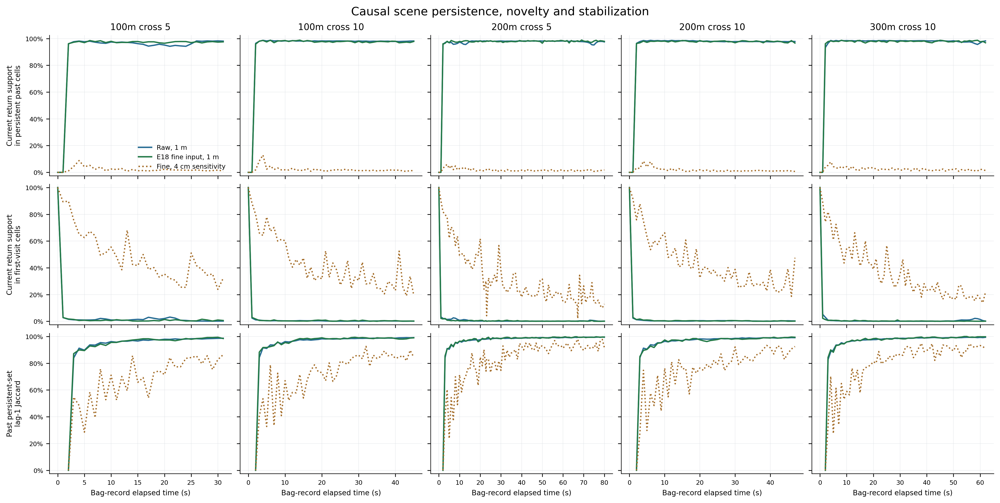
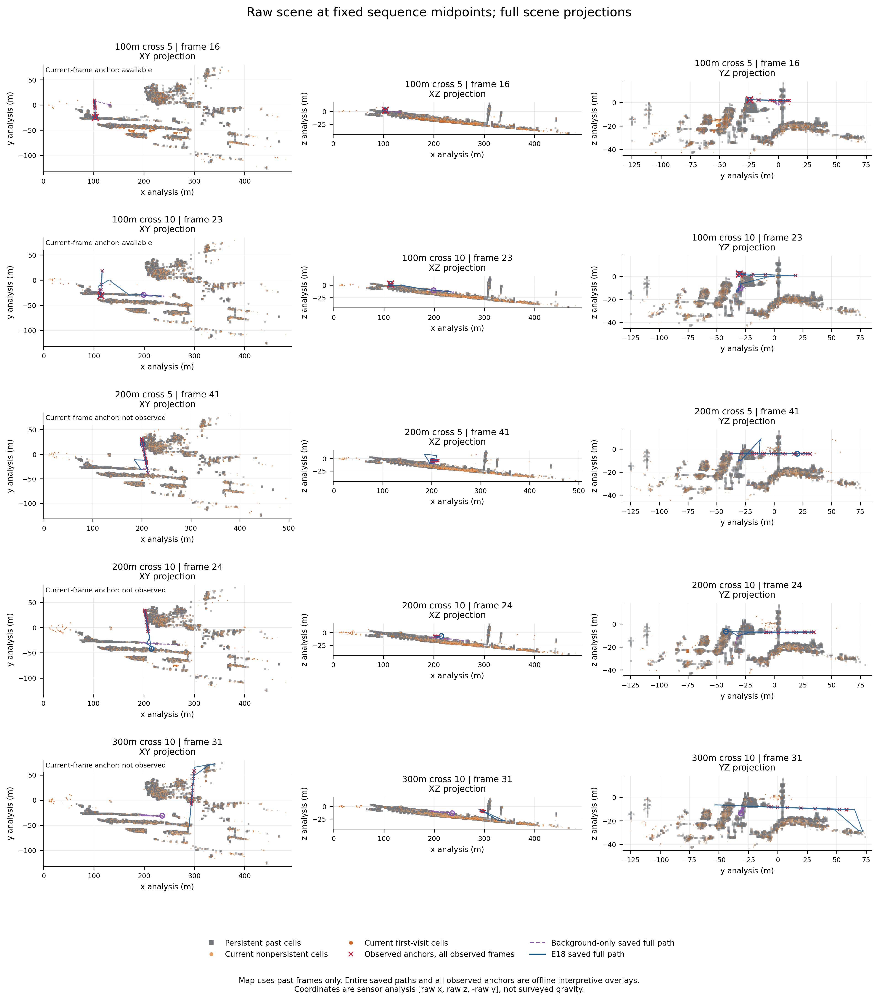
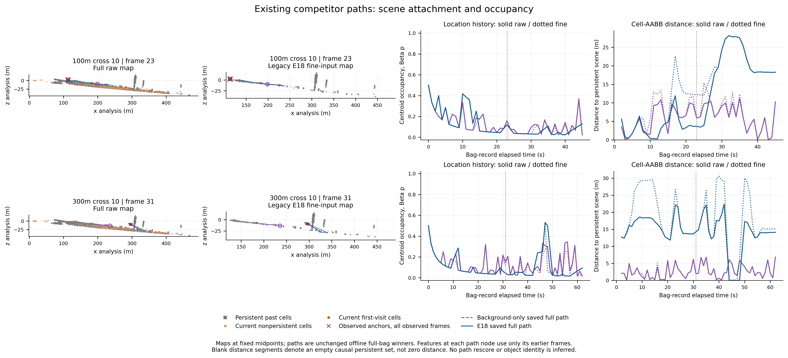
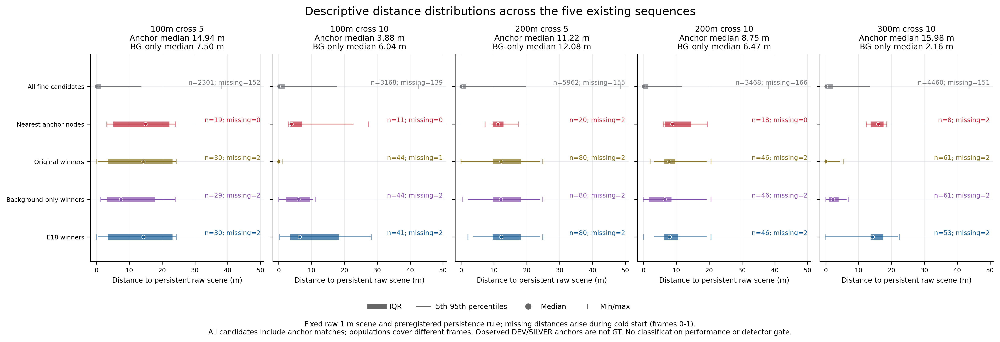
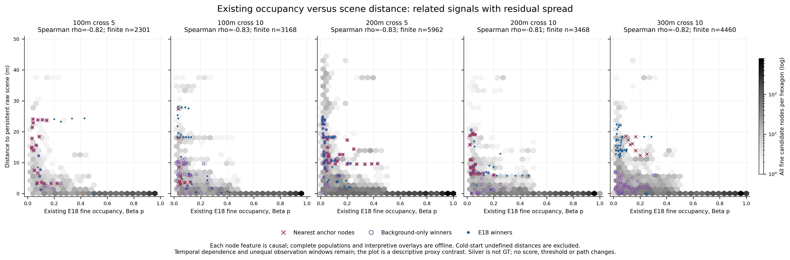

# FMCW Scene Spatiotemporal Background Audit

日期：2026-10-13。**IMPLEMENTED / TESTED / VERIFIED RESULT：描述性统计与既有路径核验；物理机制 SPECULATIVE；检测价值和场景泛化 UNKNOWN。**

完整 raw 场景在 1 m 尺度高度重复：含冷启动的持续单元回波占比为 **90.57%–95.32%**；已有至少两帧历史时为 **96.60%–98.07%**。E18 occupancy 已反映大量场景重复结构。距离提供了 occupancy 之外的空间信息，但**不支持统一的“越孤立越像 UAV”规则**：`100m_cross_10` 在 anchor 同帧，background-only 竞争路径反而更孤立；改用 E18 已筛选 fine 场景或降低描述性 persistence cutoff，该对比又会反向。这个反例与输入/规则敏感性必须保留。

没有改变 E18、graph、score、weights、阈值、labels、GNSS、calibration、offset、历史图表或 raw bag；没有新 detector、路径搜索、rescore、operating point、AUC 或 precision。结果与代码集中在 [新结果目录](results/scene_spatiotemporal_background_audit/README.md)。

## 1. 输入证据与计算顺序

已核对项目 context/status/logs/TODO、[E18 MVP](FMCW_Background_Motion_DP_MVP.md)、[E18 机制审计](FMCW_E18_Mechanism_Generalization_Audit.md)、[GNSS-conditioned phenotype](FMCW_GNSS_CONDITIONED_UAV_PHENOTYPE.md)、[GNSS–anchor 分解](results/rviz_gnss_lidar_sanity/DECOMPOSITION.md)及现有 occupancy 实现。历史报告已包含 anchor outcomes，故本审计**不是盲法或独立 held-out preregistration**；新计算规则提前冻结，历史结果不作为 scene ROI、参数或候选选择输入。

本次范围是 E18 已有五条 cross graph 对应的五个完整包，共 **272 帧、30,941,328 个有限非零 raw returns、20,122 个 fine pregeometry nodes**。不是全部归档 bags，也没有新增 closure-PASS 或泛化序列。每包单独建立历史，不跨包汇总地图；最终统计汇总不反馈任何包的背景。

| Sequence | 全帧数 | Raw returns | 既有 fine nodes |
|---|---:|---:|---:|
| 100m_cross_5 | 32 | 3,633,703 | 2,453 |
| 100m_cross_10 | 46 | 5,167,226 | 3,307 |
| 200m_cross_5 | 83 | 9,427,483 | 6,117 |
| 200m_cross_10 | 48 | 5,528,061 | 3,634 |
| 300m_cross_10 | 63 | 7,184,855 | 4,611 |

三种历史源分别保存，不能混称：

- **raw_1m，primary**：只读既有 `calibration_closure/raw_voxel_cache` 的完整 raw 1 m cells、整数 grid keys 和 raw counts。历史 broad volume 为 x `[0,520]`、y `[-250,250]`、z `[-100,120]` m；五包 `valid_returns == nonzero_returns`，该 volume 没有丢弃有效非零回波。没有 intensity/height rejection，也不读取 GNSS/外参来建图。直接用 `q+[0,-250,-100]` 恢复零原点 cell，不把 voxel mean 当作原始点重新划 cell。
- **fine_1m，E18 exact reference**：既有 4 cm fine cache 的全部中心，不限 accepted candidates；精确复现 E18 的 1 m floor 占用。该输入已经继承 x `[8,510]`、y `[-200,200]`、z `[-60,60]` m、intensity `[10,250]`、frozen-calibration leveled-height `>10 m` 筛选。保留 raw support 为 1,922,878，即完整 raw 的 **6.2146%**。它不是未经筛选全场景，也不是完全独立于历史 GNSS calibration 的输入；其用途是解释既有 E18。
- **fine_004m，唯一细尺度敏感性**：同一 fine cache 中心的固定 4 cm floor 网格。未增加尺度搜索；没有全 raw 4 cm 地图，不将 raw/fine 差异全部归因于尺度。

坐标保持 `[sensor_x,sensor_z,-sensor_y]`，不是 surveyed gravity frame。时间使用原 **bag-record time**，保留真实非均匀间隔；没有使用旧 2022 ROS header epoch，没有假设 dt=1。没有使用 phenotype 的 oracle region crops、GNSS corridor 或照片 mask。

规则于 **14:19:28.475 UTC** 冻结；完整 scene/node 计算于 **14:21:17.020 UTC** 完成，耗时 **91.203 s**，先保存 [SCENE_FEATURES_COMPLETE.json](results/scene_spatiotemporal_background_audit/SCENE_FEATURES_COMPLETE.json) 的全部输出 SHA。只有之后的独立 `interpret_scene.py` 才解析 anchors/已有路径。20,122 nodes 的 children 仅按原 E16 固定 adaptive minPts1 DBSCAN 恢复归属；component ID、中心、voxels、raw support、extent 全部精确复现，不建立或删改候选。

## 2. 冻结的 causal scene 定义

frame index 使用已有零基编号 f。当前帧仅查询 `0…f−1` 的历史；每 cell 每历史帧最多计一次，空帧仍计入分母。`F=f`、`H=previous occupied-frame count`：

```text
prior_rate = H/F                         # F=0 时 UNKNOWN
p_beta11 = (H+1)/(F+2)                   # 精确沿用 E18
b_E18 = 1−2*p_beta11                     # 只核验，不加入新 score
persistent = previously_seen AND H>=2 AND p_beta11>=0.5
first_visit = H==0
low_revisit = H<=1                       # 包含 first-visit
current_nonpersistent = current occupied cell outside prior persistent set
```

0.5 是既有 E18 background contrast 的零点；H≥2 避免称一次历史 hit 为持续结构。0.25/0.75 在冻结时同时指定，仅做敏感性，不挑有利结果。所有当前 occupied cells 保存 H、rate、Beta p、距上次占用的 bag 时间、first/revisit、先前最长连续占用 run、历史 occupied episodes、当前 raw/fine 权重和 persistent 状态。连续 run 遇缺帧或空帧中断；它描述采样记录而非未观测期间的物理持续性。

每个 fine node 保存 centroid occupancy、`distance_to_persistent_scene`、5 m 球内 persistent cell-centre 数量/体积密度，以及原 fine children 中重叠的中心比例、保留 raw-support 权重比例、unique-cell 比例。原 raw point IDs 不在 fine cache，**不声称恢复了逐 raw 点的几何或身份**。距离是到历史 grid cells 的闭 AABB 并集的精确距离，不是“UAV height”，也不是 surveyed surface distance。Persistent set 为空时距离 NaN/UNKNOWN、density 0；cold start 不填零距离。

## 3. 场景有多重复：raw 主结果

下表同时显示全时段和 F≥2 的结果；后者是 persistent 至少可能成立的历史支持条件，不是按 anchor outcomes 排除帧。Return fractions 按 current raw count 加权；cell fractions 按 current occupied cells 计数，二者不能互换。细节见 [sequence summary](results/scene_spatiotemporal_background_audit/sequence_scene_summary.csv) 与 [cutoff sensitivity](results/scene_spatiotemporal_background_audit/persistent_cutoff_scene_sensitivity.csv)。

| Sequence | 全时段 persistent 回波 % | F≥2：已有占用回波 % | F≥2：persistent 回波 % | F≥2：persistent current cells % | F≥2：first-visit / low-revisit 回波 % | novel cells/frame median |
|---|---:|---:|---:|---:|---:|---:|
| 100m_cross_5 | 90.57 | 98.82 | 96.60 | 83.09 | 1.18 / 1.91 | 241.5 |
| 100m_cross_10 | 93.82 | 99.70 | 98.07 | 84.42 | 0.30 / 0.56 | 97.0 |
| 200m_cross_5 | 95.32 | 99.62 | 97.67 | 83.29 | 0.38 / 0.68 | 80.0 |
| 200m_cross_10 | 93.87 | 99.67 | 97.95 | 84.43 | 0.33 / 0.62 | 135.5 |
| 300m_cross_10 | 94.88 | 99.61 | 98.00 | 84.15 | 0.39 / 0.64 | 87.0 |

因此 F≥2 的 current nonpersistent 结构承载 **1.93%–3.40% 回波**，却占 **15.57%–16.91% current cells**。稀疏变化单元的数量不能替代回波占比。Novel/current-nonpersistent 不等于 UAV、dynamic object 或 certified clutter；它也可能是同一表面的采样抖动、扫描落点变化、低强度间歇回波、遮挡或未观测暴露。

固定 cutoff 0.25/0.5/0.75 下，F≥2 raw persistent 回波比例分别落在 **97.55%–99.05% / 96.60%–98.07% / 94.21%–96.05%**，总体高度重复的方向保留；cutoff 改变的是描述性集合，不能用 anchors 选择其中一项。

**时间变化**：[固定 milestones](results/scene_spatiotemporal_background_audit/fixed_causal_time_milestones.csv) 显示 raw persistent set 的 lag-1 Jaccard 在 frame5 为 **0.898–0.911**、frame10 为 **0.959–0.965**、frame20 为 **0.977–0.982**、末帧为 **0.987–0.995**；这里的 frame 编号零基。不是用阈值拟合一个“稳定时刻”。末三分之一 novel-cell median 降至 61–109.5；300 m 的 raw first-visit 回波比例末三分之一反而为 0.68%，高于其全 F≥2 的 0.39%，不能声称 novelty 单调消失。

**空间分布**：按固定物理 10 m cubes 聚合，F≥2 raw persistent cells 的 top10 cubes share median 约 **22.64%–22.87%**，HHI **0.01119–0.01134**；在传感器坐标下跨多个结构分布，不是一个小目标区。完整逐时空间范围和分布表保留，未用 anchor 位置裁剪。五包相似场景不能视作五个独立场景。

**唯一细尺度反例**：同一 fine 输入在 1 m 下 F≥2 persistent 回波占比 **97.38%–97.88%**，4 cm 下仅 **1.75%–2.45%**；4 cm first-visit 为 **30.39%–46.25%**。这支持“1 m 聚合稳定场景结构，而细采样坐标持续改变”的解释候选，不证明该场景多数物体在运动，也不证明哪种尺度适合作为检测参数。

## 4. Anchors 与全部 fine nodes：事后描述

关联只用已有 80 observed DEV/SILVER centers 与原 3 m gate。保留所有 gate 内 nodes，另报最近 node，未移动/插值 anchor。距离有历史支持的 observations 是 **76/80**：`200m_cross_5` 和 `300m_cross_10` 各自 frame0、frame1 的 cold-start 距离 UNKNOWN；80/80 均有既有 fine node 匹配。表中距离针对 nearest matched node；直接 anchor position 的结果另保留，两者不是点级 UAV 标签。

| Sequence | finite anchor nodes / anchors | raw scene distance median / IQR（m） | 同帧 all-node 距离 percentile median | 与全 bag all nodes 的 Cliff δ |
|---|---:|---:|---:|---:|
| 100m_cross_5 | 19/19 | 14.938 / 17.050 | 0.942 | +0.850 |
| 100m_cross_10 | 11/11 | 3.878 / 3.458 | 0.816 | +0.707 |
| 200m_cross_5 | 20/22 | 11.219 / 3.272 | 0.918 | +0.821 |
| 200m_cross_10 | 18/18 | 8.755 / 8.125 | 0.936 | +0.861 |
| 300m_cross_10 | 8/10 | 15.977 / 3.930 | 0.967 | +0.926 |

All-node raw distance median 为五包均 **0 m**，Q75 为 **1.30–2.08 m**。Nearest matched nodes 的 retained raw-weight persistent overlap 为 **80/80 零**；全部 gate 内 matched nodes 为 **84/84 零**。5 m local density 对 nearest group 的100m_cross_10 median cell-centre count 为 **5**，其余序列 median 为 **0**。空 persistent set 下 overlap 0 是定义的集合重叠结果，不证明自由空间；finite distance 分开处理。

Cliff δ 是 selected observations 与包含它们的未标注 candidate population 的**描述性 proxy contrast**，不是 UAV-vs-clutter classification，样本时间相关、full-period 支持不同，没有独立 negative labels。不能转写为 operational AUC/precision。全部 matched nodes、nearest nodes、fixed old-score silver feasibility witness、既有四组 unconditional winners 和历史参考的分布/缺失/效应均保留于 [population summaries](results/scene_spatiotemporal_background_audit/population_distribution_summary.csv)、[effects](results/scene_spatiotemporal_background_audit/descriptive_effect_sizes.csv) 和 [same-frame contrasts](results/scene_spatiotemporal_background_audit/same_frame_winner_contrast_summary.csv)。

历史五条 `persistent-clutter reference` 路径在 raw 场景的距离 median 均为 **0 m**，fine occupancy median **0.828–0.977**；该名称沿用历史 reference 身份，不是本审计创建 certified clutter labels。100m_cross_5 参考有少量早期离开 persistent set 的位置，保留最大距离 **15.182 m**，不把每个 reference 点都称 static。

## 5. 竞争路径与反证

Fine original/E18 winners 在三个序列已有 anchor matches，不能整体当 clutter。重点是原报告中 `100m_cross_10`、`300m_cross_10` 的 original/background-only 非银标赢家；以下各行是**已保存原路径**，没有 rescore。

| Sequence / path | 全路径 fine p median | raw distance median（m） | finite nodes 距离=0 % / >5 m % | 几何速度 median / max（m/s） | 描述 |
|---|---:|---:|---:|---:|---|
| 100m_cross_10 original | 0.643 | 0.000 | 72.73 / 0.00 | 0.114 / 0.347 | 高重访，贴持续 cell，位置近静止 |
| 100m_cross_10 background-only | 0.089 | 6.040 | 0.00 / 65.91 | 5.585 / 18.889 | 低重访，既有近结构片段也有较孤立片段 |
| 300m_cross_10 original | 0.867 | 0.000 | 75.41 / 3.28 | 4.052 / 17.551 | 高重访位置贴结构，但路径跨不同位置，不能称单个静止物体 |
| 300m_cross_10 background-only | 0.083 | 2.160 | 0.00 / 14.75 | 4.578 / 20.113 | 低重访，多数位置仍近持续结构 |

5 m 只是预冻结 density 邻域的几何参照，未成为 score 或 detection gate。Path speed 是相邻 candidate centres 的 bag-time 差商，不是认证物体速度；最大步长分别可达 **18.878 / 19.758 m**（两条 background-only 路径）。图可满足原 graph 的运动 gate，仍可能是跨对象关联或表面采样的连接，不能把轨迹连线自动解释为一辆车或一个运动物体。

[独立 contrast 核验](results/scene_spatiotemporal_background_audit/independent_contrast_audit.json) 记录：300 m background-only 的既有 frame3–19 片段共 **17 nodes / 16.003 s**，p<0.25 且 distance≤5 m，distance median **0.981 m**。这里的 0.25 和 5 m 来自已有冻结描述参照，并非新 gate。该片段存在多次反向，整条 background-only 路径的相邻转向超过90°比例约 **54.1%**（100m_cross_10 为47.7%）；支持低 occupancy、近结构的候选证据存在，**不确认 coherent physical object**。

**同帧比较是关键反例**：

- `100m_cross_10`，11 个 finite anchor 同帧：anchor-node 距离 median **3.878 m**，background-only **6.584 m**；逐帧 anchor−competitor 差 median **−2.763 m**，仅 **2/11** 帧为正。原 original 在这些帧距场景 median 0，距离可区分原高重访参考，但不能普遍排除更 novel 的竞争者。
- `300m_cross_10`，8 个 finite anchor 同帧：anchor-node **15.977 m**，background-only **1.985 m**；paired 差 median **+14.091 m**，8/8 为正。其余两帧无 prior persistent scene 距离，不能填零或算有利 hit。
- 另三包的 original/background-only/E18 很多同帧路径已是 anchor-matched evidence，所以这些组的 paired median 差 **0**，不是距离失效，也不是距离新增收益证据。Motion-only 另保留其不同路径和非零差异，不归入此结论。

**输入和 cutoff 敏感性**：100m_cross_10 的 raw-map paired 差在 cutoff **0.25 / 0.5 / 0.75** 为 **+2.752 / −2.763 / −4.785 m**；同一 frozen node/path 用 E18 fine-map 为 **+11.795 / +5.941 / +3.928 m**。fine 的预筛选移除了 raw 场景中较近的结构，不能把更“干净”的距离当更真实的自由空间。300 m raw-map 同三 cutoff 为 **+14.198 / +14.091 / +12.925 m**，方向保留。没有因此选择 0.25 或只报告 fine 输入。

## 6. 距离是否只是 occupancy 的别名？

两者关联很强，raw distance 与既有 E18 fine p 的全 fine-node Spearman 为：

| Sequence | ρ(distance_raw, p_E18) | 同一帧 H=0 组：distance IQR 的逐帧 median（m） |
|---|---:|---:|
| 100m_cross_5 | −0.816 | 8.243 |
| 100m_cross_10 | −0.830 | 8.017 |
| 200m_cross_5 | −0.826 | 10.991 |
| 200m_cross_10 | −0.812 | 7.627 |
| 300m_cross_10 | −0.818 | 7.651 |

后一列使用同 source raw H=0、同 frame 的 nodes，至少两个 finite 距离才计组；此时它们的 p **完全相同**。距离仍有明显几何展开，固定分组中最大 range 约 **37.25–43.27 m**。说明距离**数值上不由 occupancy 唯一决定**，而非另一种代数表达；但 H≥2 且 p≥0.5 的 centroid 位于 persistent cell，AABB distance 必然 0，所以整体强相关部分由集合定义造成。

不能由该展开推断独立检测信息、因果解释或在类别条件下的统计独立。Range、原预筛选、centroid/children 不一致、结构缺采样、occupancy support 及时间历史共同影响距离。尤其 100m_cross_10 的反向和 cutoff 敏感性说明，非冗余不等于可稳定加入分数。完整 [associations](results/scene_spatiotemporal_background_audit/occupancy_distance_associations.csv)、[bins](results/scene_spatiotemporal_background_audit/distance_within_occupancy_bins.csv)、[同帧 H0 展开](results/scene_spatiotemporal_background_audit/same_frame_H0_distance_spread.csv) 保留，不做 regression/rescore 或阈值优化。

对**既有 E18 fine occupancy 完全相同**的 anchor/competitor 同帧配对，300 m 有7帧，7/7 anchor 距离更大，frame4 为 **13.932 对0.025 m**；100m_cross_10 也有7帧，其中6帧 anchor 更近、1帧更远。这个直接对照既证明非代数重复，也保留其方向不稳定；不是额外检测收益。

## 7. 诊断图与验证

所有图提供 PDF 与 300 dpi PNG，使用 full-scene范围；每包代表帧固定为 `floor(n_frames/2)`，即 **16/23/41/24/31**，不依据 anchor 表现挑帧。灰色是该帧之前的 persistent cells；橙色是当前 novel/nonpersistent cells；红色 anchors 仅用于事后解释。整条 saved path/anchor trajectory 是离线全时段叠加，明确区别于当前 causal map；不能把整条 trajectory 当当前帧真值。Analysis z 不命名为物理高度。没有使用照片作任何算法 mask。











**TESTED**：[独立验证](results/scene_spatiotemporal_background_audit/validation.json) 的 6 个 synthetic tests 通过，包括空帧/重复 occupancy、替换未来后的 prefix invariance、逐包 reset、无历史 persistent set、KDTree 对暴力 AABB/球查询、children overlap。独立复算 **816 frame/source records、4,134,250 current occupied-cell records、140,854 node-feature records**；20,122 个 E18 H/p/b 精确一致；固定首/中/末帧 **3,456** 个 node 几何与暴力计算一致。**358 protected scientific files**、30 compute inputs、33 scene outputs SHA 均不变。Membership 由冻结 compute 的全量 identity assertions 核验，validator 没有独立重跑 DBSCAN。

保留实现限制：冻结输出的 `fine_004m` 原 spatial-concentration 列使用 `cell_index//10`，实际是 **0.4 m cubes**，原列名 10 m 不正确；没有覆盖原结果，独立后处理生成 [corrected_spatial_concentration.csv](results/scene_spatiotemporal_background_audit/corrected_spatial_concentration.csv)，所有 source 均按物理 10 m 算，报告引用此表。Raw/fine 1 m 原浓度列正确。此问题不影响 occupancy、distance、node features 或主 raw 结论。

## 8. 明确回答 A–G

**A — Persistent versus transient？** 以冻结 1 m 描述规则，F≥2 raw persistent 占 96.60%–98.07% 回波、83.09%–84.43% occupied cells；其余是 nonpersistent，真实动态比例 UNKNOWN。完整冷启动结果 90.57%–95.32% 也保留。4 cm 的低 persistence 反证了把 novelty 直接解释成动态的做法。

**B — E18 occupancy 是否已捕获多数 usable static scene？** 捕获高重访结构的描述证据强：fine 历史 p 精确复现，历史 persistent references 与多数 candidate 贴 persistent cells。但其原输入只保留 6.21% raw support；“多数可用于检测的信息已被捕获”的效用命题仍 UNKNOWN，不能由重复回波总占比或旧固定参考推导。

**C — UAV observed anchors 是否更远？** 对 all candidates、历史 persistent references，五包选择性 anchor-matched evidence 的距离总体更大；不能称独立 UAV 标签。对 background-only 非银标赢家，300 m 支持、100m_cross_10 反向；另外三包多为相同 anchor-matched path，不能支持普遍额外分离。

**D — 近 persistent surfaces 的 transient coherent structures？** 存在低重访且近 scene 的既有路径片段，尤其 300 m background-only。但只能确认候选连线的几何/时间模式；连线跨位置和较大步长，不足以确认一个连续物理对象。Road/vegetation/water dynamic clutter 是与模式兼容的假设，真实类别及 coherence UNKNOWN；不称未标对象为车。

**E — 非冗余？** 数值上是：相同 H/p、同帧仍有不同 scene distances。整体相关很强，并部分由 persistent 集合定义引起；是否提供独立且稳定的类别/检测信息 UNKNOWN，100 m 反例与 sensitivity 阻止升级分数。

**F — 五个 closure-PASS cross / nominal ranges 的方向？** 1 m 场景重复、anchor 相对 all-node 的较远位置、距离/occupancy 强负关联在五包方向相近。Anchor 对 novel competitor 的分离不一致，100m_cross_10 原 raw 主规则反向；没有声称 scene generalization 或跨范围单调规律。

**G — 升级 score 前缺什么？** 独立 timestamp-linked presence/FOV/点或对象身份、认证 occupied dynamic clutter 与 target-absent windows、dense state/scan exposure 与地图缺采样边界、moving→hover/revisit stress、不同场景/日期/范围的锁定 held-out 集，以及冻结完整预处理/map/cold-start定义后的独立消融。需要证伪 distance 是否只是预筛选/缺采样或关联 artifact，并验证 slow/hover 风险；本轮没有启动这些试验。

## Observed phenomenon -> candidate physical/statistical mechanism -> alternative explanation -> required held-out falsification

| Observed phenomenon | Candidate physical/statistical mechanism | Alternative explanation | Required held-out falsification |
|---|---|---|---|
| 1 m 的多数回波持续，4 cm 同 fine 输入却大量首次访问 | Persistent scene structure 与细扫描落点/测量抖动共同存在 | 真正局部运动、遮挡、强度间歇和扫描曝光变化 | 在独立静态参考场景记录扫描/ray exposure，检验细 novelty 是否仍高；不靠 UAV outcomes 选尺度 |
| Anchor-matched evidence 比多数 nodes 更远，但 100m_cross_10 competitor 更孤立 | 距离含结构邻接信息，超出单 cell revisit | Anchor选择、range/height预筛选、地图缺采样、跨对象关联 | 独立 occupied negative 与不同场景上，同步认证 identities；若匹配控制后方向消失/反转则否定稳定隔离 cue |
| 300 m 有低 occupancy、近结构的既有竞争路径片段 | 表面邻近的时变返回可能形成 coherent candidate evidence | 扫描抖动、关联拼接，并非真实移动对象 | 同步影像/密集 state 核对每条路径对象连续性；若路径拼接不同物体则否定单对象机制 |
| 100 m raw/fine 和 cutoff 改变对比方向 | 预处理/持续集合选择改变最近可见结构 | 真实目标与环境间距随时间改变；稀疏采样支撑不足 | 锁定 raw 场景和 exposure，在 held-out 数据检验输入/cutoff敏感性；禁止挑有利版本 |
| 同帧同 H=0，distance 仍广泛展开；总体与 occupancy 强负相关 | Cell novelty 与周围结构几何是不同统计量 | Grid/centroid 空洞、range/history混杂产生表面非冗余 | 独立同 occupancy/range/support 控制下检验距离描述是否保留；失效则否定其稳定附加信息，不据本轮设 score |
