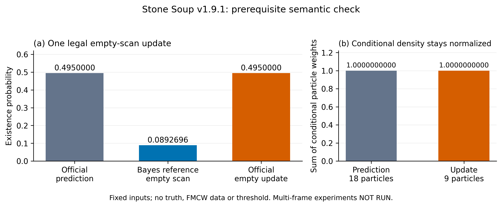

# Stone Soup Bernoulli Existence Reproduction — v1.9.1

日期：2026-10-14（Asia/Shanghai）。**结果：STOPPED_AT_EMPTY_SCAN_SEMANTIC_GATE；完整复现未成功。** 本次是外部合成语义核查，不是FMCW实验；没有使用FMCW DEV bags、anchors、scores、GNSS或calibration结果选择参数/评价成功，没有修改E18、上游算法或受保护科学结果。遵守 [STOP_DEV_FEATURE_MINING](docs/DEV_FEATURE_MINING_STOP.md)；本轮未commit/push，留待用户审阅。

**REPRODUCED：** 锁定官方版本的7个相关测试全部通过；但一个合法、固定正检测概率的有效空扫描，在官方updater中保留 `r_post=0.495`，而等价Bernoulli空扫描Bayes后验应为 `0.08926961226330025`。这不是粒子权重未归一化：预测与更新权重之和均约1。由于继续实现预期漏检衰减需要改变官方更新逻辑，本轮按停止条件终止，未生成多帧场景或执行A/B/C控制。

`VERIFIED` 指直接核对的官方源码/版本事实；`REPRODUCED` 指本机实际执行的数值/测试；`SPECULATIVE` 为未来相关性；`UNKNOWN` 为未执行或未解决事项。完整执行证据见 [结果目录](results/external_reproductions/stonesoup_bernoulli_v191/README.md)。

## 版本、隔离环境与安装

**VERIFIED：** 从 [官方release v1.9.1](https://github.com/dstl/Stone-Soup/releases/tag/v1.9.1) 克隆指定tag，执行前核对annotated tag object `d9e6fb16f5ae176817aeb6a6fc3a39f544694408` → commit **`a4336b920a799cfe0a77ecb05867c5deeb371c7a`**，checkout HEAD相同。没有使用floating main/latest。官方测试从该checkout导入；独立标量检查从安装后的1.9.1导入，7个已安装核心源码hash与锁定源码一致。[source_identity.json](results/external_reproductions/stonesoup_bernoulli_v191/source_identity.json)。

工作目录：`external_reproductions/stonesoup_bernoulli_v191/`；独立环境：其下 `.venv/`，不共享system site-packages，不含原`fmcw`环境路径。Python **3.10.12**；NumPy **2.2.6**、SciPy **1.15.3**、pytest **9.1.1**。完整 [environment.txt](results/external_reproductions/stonesoup_bernoulli_v191/environment.txt) / [pip freeze --all](results/external_reproductions/stonesoup_bernoulli_v191/pip_freeze.txt)。未使用sudo、apt、系统包/ROS修改或原fmcw环境安装。

实际安装路径与命令：

```bash
# cwd=/home/xin/FMCW_LIDAR
git clone --depth 1 --branch v1.9.1 --single-branch https://github.com/dstl/Stone-Soup.git external_reproductions/stonesoup_bernoulli_v191/upstream
git -C external_reproductions/stonesoup_bernoulli_v191/upstream rev-parse HEAD refs/tags/v1.9.1 'refs/tags/v1.9.1^{commit}'
virtualenv --clear --no-download --python /usr/bin/python3 external_reproductions/stonesoup_bernoulli_v191/.venv
cd external_reproductions/stonesoup_bernoulli_v191
.venv/bin/python -m pip install --index-url https://pypi.tuna.tsinghua.edu.cn/simple ./upstream pytest
```

环境问题完整保留：首次 `python3 -m venv` 因系统缺`ensurepip`失败，改用机器已存在的virtualenv 21.5.1，无系统安装。首次默认PyPI安装因持续低吞吐主动中断，保留`Operation cancelled by user`，不是算法/依赖兼容失败；清华PyPI镜像重试成功，仅安装release声明的基础依赖与pytest，没有docs/video/ML extras。Rtree通过wheel满足，无需系统库改动。`pip check`返回无broken requirements。见 [初次venv日志](results/external_reproductions/stonesoup_bernoulli_v191/venv_creation.log)、[初次安装日志](results/external_reproductions/stonesoup_bernoulli_v191/install.log)、[成功安装日志](results/external_reproductions/stonesoup_bernoulli_v191/install_mirror.log)。

## 官方组件测试先行

**REPRODUCED：7 passed，71 deselected，0 failed（pytest报告0.24s）。** NumPy seed=191。此步完成后才创建本地标量核查脚本。精确命令与pytest参数见 [commands.log](results/external_reproductions/stonesoup_bernoulli_v191/commands.log) / [完整stdout/stderr](results/external_reproductions/stonesoup_bernoulli_v191/official_test_results.txt)。

| 官方test node ID（相对upstream） | 结果 |
|---|---|
| `stonesoup/predictor/tests/test_particle.py::test_bernoulli_particle_no_detection[standard_bernoulli]` | PASS |
| `stonesoup/predictor/tests/test_particle.py::test_bernoulli_particle_detection[standard_bernoulli]` | PASS |
| `stonesoup/updater/tests/test_particle.py::test_bernoulli_particle[True-standard_bernoulli]` | PASS |
| `stonesoup/updater/tests/test_particle.py::test_bernoulli_particle[False-standard_bernoulli]` | PASS |
| `stonesoup/types/tests/test_state.py::test_particle_get_item[BernoulliParticleState]` | PASS |
| `stonesoup/types/tests/test_state.py::test_particle_parent_parent[BernoulliParticleState]` | PASS |
| `stonesoup/types/tests/test_prediction.py::test_particle_parent_parent[BernoulliParticleStatePrediction]` | PASS |

筛选表达式为 `(bernoulli and not vis_informed) or BernoulliParticleState`。排除项是同四个文件内的非Bernoulli组件和visibility-informed扩展；本任务只测标准、固定scalar P_D模型，没有排除失败的相关standard测试。官方updater测试只使用真实Detection，检查r不为None；predictor的no-detection测试检查预测，不检查空扫描测量后验。因此7项通过不能替代下述门槛。[锁定predictor tests](https://github.com/dstl/Stone-Soup/blob/a4336b920a799cfe0a77ecb05867c5deeb371c7a/stonesoup/predictor/tests/test_particle.py)、[锁定updater tests](https://github.com/dstl/Stone-Soup/blob/a4336b920a799cfe0a77ecb05867c5deeb371c7a/stonesoup/updater/tests/test_particle.py)。

## 源码语义与合法漏检输入

详细逐项解释及精确行号见 [source_semantics.md](results/external_reproductions/stonesoup_bernoulli_v191/source_semantics.md)。**VERIFIED：** `BernoulliParticleState.existence_probability`独立保存r；粒子权重描述条件状态密度s(x)，总和应为1，而非r。Predictor在`estimate_existence`中使用 `p_B*(1-r)+p_S*r`，并在条件粒子权重中分别组合出生与存活分量；p_B/p_S每调用使用一次。出生采样可使用prior假设中的过去测量，无测量时可用预定宽分布，不能使用未来truth。[状态定义](https://github.com/dstl/Stone-Soup/blob/a4336b920a799cfe0a77ecb05867c5deeb371c7a/stonesoup/types/state.py#L942-L995)、[预测器](https://github.com/dstl/Stone-Soup/blob/a4336b920a799cfe0a77ecb05867c5deeb371c7a/stonesoup/predictor/particle.py#L280-L405)。

**VERIFIED：** updater使用每粒子同一个P_D；`clutter_rate`是Poisson每scan期望杂波数λ，`clutter_distribution`是测量空间密度c，乘积λc进入测量似然比。真实检测分支同时改变r和归一化条件粒子权重。[锁定updater](https://github.com/dstl/Stone-Soup/blob/a4336b920a799cfe0a77ecb05867c5deeb371c7a/stonesoup/updater/particle.py#L443-L547)。

本次实际使用的合法输入：

```python
MultipleHypothesis([
    SingleHypothesis(prediction, MissedDetection(timestamp=prediction.timestamp))
])
```

**REPRODUCED：** 该容器长度1，单个hypothesis布尔值为False，`any(hypotheses)==False`。`any`判断是否至少有一个真实测量假设，不是容器是否非空，也不判断测量真的是目标还是杂波。**VERIFIED：** 普通`[]`缺`.single_hypotheses`，空`MultipleHypothesis([])`缺首个prediction，二者都不是本调用的合法空扫描表示；本次没有用它们作为反例，也没有伪造Detection以强制进入更新分支。

## 闭式算术与本机单步结果

[protocol.json](results/external_reproductions/stonesoup_bernoulli_v191/protocol.json)在本地核查执行前写入，并有 [SHA-256冻结收据](results/external_reproductions/stonesoup_bernoulli_v191/protocol_receipt.json)：`d9657d13d3ef0207efcd736e45da7aab7147615f2d5023360e8670550185e076`。r=.5、P_D=.9来自官方组件测试取值，p_B=.01、p_S=.98也等于官方默认；其余仅定义一个小型语义核查，不作搜索。使用普通IEEE binary64算术，另用60位Decimal交叉核对；参考值在import Stone Soup前计算/保存。

| 固定设置 | 值 |
|---|---|
| seed / state | 191；1D constant velocity `[position, velocity]` |
| prior | r=.5；9个固定位置−4,…,4，速度0；条件权重均匀；无truth输入 |
| birth | 9个预定均匀backup samples，状态矩形`[-10,10]×[-1,1]`；不以未来位置初始化 |
| process / measurement | process diffusion=0；position测量方差1 m²；dt=1s |
| clutter model | Poisson λ=2/scan，uniform c=.05/m；此门槛条件为已观测空集，不生成随机clutter实现 |
| updater | P_D=.9；SystematicResampler回到9粒子；无regulariser/constraint |
| 容差 | absolute/relative均1e−12；不是检测阈值 |

独立公式：

\[
r^-=.01(1-.5)+.98(.5)=.495,\qquad
r_{\varnothing}=\frac{.495(1-.9)}{1-.495(.9)}
=.08926961226330025\quad\text{(binary64)}.
\]

**REPRODUCED：** Decimal60交叉值为`.0892696122633002705139765554553651938683498647430117222723174`；binary64与其转换值绝对差约1.39e−17。

| 实际核查量 | 结果 |
|---|---:|
| 官方predictor r_pred | 0.495，匹配公式 |
| 官方updater r_post | **0.495，不匹配空扫描Bayes后验** |
| 绝对差 | **0.4057303877366997** |
| prediction / update粒子数 | 18 / 9 |
| prediction / update权重和 | 0.9999999999999998 / 0.9999999999999998 |
| prediction / update ESS | 9.183654346694432 / 9.000000000000004 |

r与粒子权重均有限，r在[0,1]；这些局部数值健全不等于漏检存在性语义正确。结果及完整权重向量见 [closed_form_check.json](results/external_reproductions/stonesoup_bernoulli_v191/closed_form_check.json) / [执行日志](results/external_reproductions/stonesoup_bernoulli_v191/closed_form_execution.txt)。首次本地脚本漏用`StateVectors`包装多粒子数组，在predictor/updater前触发ValueError；原脚本、traceback与参考算术已归档。只改本地输入容器后按同一冻结protocol重跑；没有调参数或改上游源码。



图为实际单步值；蓝柱仅是独立数学参考，**没有覆盖官方返回值**。无多帧轨迹、truth overlay或阈值。[矢量PDF](results/external_reproductions/stonesoup_bernoulli_v191/closed_form_check.pdf)。

## 差异解释、停止与未执行范围

对有效空扫描、固定正P_D及Poisson杂波，空杂波因子exp(−λ)在目标存在/不存在两种似然中抵消，不能解释返回值差异。常数P_D下空扫描也不改变条件空间密度；重采样可改变有限粒子实现，但不应取消r的Bayes修正。源码在`if any(hypotheses)`内才更新r；合法missed-only容器使该分支跳过，复制的预测r被保留。这是本次锁定版本、合法输入、固定模型下**实际执行的数值不一致**，不泛化到所有Stone Soup算法/版本。

没有发现使两式不等价的附加模型项。传感器关闭/P_D=0会是不同模型，但本次协议明确有效观测、P_D=.9，不能用该替代解释消除差异。独立审阅重新计算公式并核对类型/分支，没有再次运行滤波器，见 [independent_review.md](results/external_reproductions/stonesoup_bernoulli_v191/independent_review.md)。

**停止条件触发：** 要让该官方路径产生预期漏检后验，需改变其算法/返回值；用户明确禁止。本轮不patch、不自行替代更新公式、不联系/提交上游问题，也不继续“漂亮曲线”实验。上游是否另有针对该调用的约定或后来修复为 **UNKNOWN**；本任务不查询/切换其他版本补救。

| 后续项 | 状态及含义 |
|---|---|
| 一个完整A–E多帧场景protocol / schedule | **NOT_FROZEN / NOT_GENERATED**；当前protocol仅冻结先决单步门槛 |
| A 原定场景 | **NOT_RUN** |
| B 相同clutter、移除target detections | **NOT_RUN** |
| C 短区间deterministic empty-scan control | **NOT_RUN**；已执行的是前置单步检查，不能冒称短区间衰减已复现 |
| `synthetic_schedule.csv`及三份trace CSV | 仅header，0 data rows；表示未运行，不是零测量/零存在或阴性实验结果 |
| 存在概率vs scan、truth overlay | **NOT_PRODUCED**，不从单步值虚构轨迹 |

停止状态和每个CSV的含义保存在 [execution_status.json](results/external_reproductions/stonesoup_bernoulli_v191/execution_status.json)；[validation.json](results/external_reproductions/stonesoup_bernoulli_v191/validation.json)逐项区分已核查、失败和未测。源身份/7项测试/单步概率和权重健全性通过；合法漏检的目标数学行为未复现，因此不能满足完整成功标准。尚未研究synthetic birth、两次漏检、多帧消失或clutter-only存在轨迹，更没有任何分类或FMCW性能结论。

## 最终解释：A–F

**A. What does Bernoulli existence probability represent that E18 currently does not?**

r表示给定观测与模型后，目标集合基数为1而非0的概率；s(x)表示“若目标存在，它在哪里”。两者组合为`P(empty)=1−r`、`density({x})=r*s(x)`。归一化粒子权重不等于存在概率。按本任务已指定的研究边界，E18的occupancy/path score不是这种经过目标缺席观测模型更新的基数后验；本轮没有读取其scores来判断结果。

**B. What mathematical evidence causes existence to decrease on a missed detection?**

有效观测为空时，存在目标下漏检的似然相对不存在目标下降，Bayes odds乘以`1−P_D`；等价得到`r_empty=r_pred*(1−P_D)/(1−r_pred*P_D)`。这要求有实际观测机会及可信P_D。传感器关闭或未知曝光不是同一事件。本轮独立算术复现了该公式，但官方锁定missed-only分支没有产生相应下降。

**C. How does clutter enter the update, and why is E18 occupancy probability NOT directly interchangeable with clutter density?**

在真实检测分支，target measurement likelihood相对杂波强度`κ(z)=λ*c(z)`进入存在性和条件状态更新；λ为每scan期望计数，c是测量空间密度，具有相应空间单位。历史cell occupancy是无量纲的重复占用频率，不给出每scan测量生成率、连续测量空间密度或目标/非目标似然。二者没有直接代换关系；空扫描时Poisson杂波公共因子抵消也不意味着一般非空更新可忽略clutter。

**D. What assumptions in the synthetic model are currently unavailable or unjustified for our FMCW UAV data?**

固定/已知P_D、单目标至多一测量、已知CV动态与Gaussian噪声、规定出生空间先验和按scan的birth/survival、Poisson独立均匀杂波及已知观测曝光，均是外部模型假设。是否适用FMCW、多返回/候选如何变成测量、速度字段/误差、背景相关性与目标缺席证据，本任务不使用DEV结果推定，均为 **UNKNOWN**。本轮也没有执行完整synthetic序列以验证其组合行为。

**E. Does this reproduction justify adding a Bernoulli layer to E18 now?**

**NO。** 首先，锁定官方组件未通过本次合法空扫描的存在更新门槛；其次，即使完整synthetic复现成功，也不提供真实传感器P_D、clutter likelihood、独立存在/缺席GT或校准证据。STOP_DEV_FEATURE_MINING继续生效，不新增E18层、feature、weight或E21/E22 score。

**F. Exactly what new real data/statistics would be required before a Bernoulli existence layer could be scientifically tested on FMCW UAV sensing?**

需要新的、独立于已关闭DEV集的预注册数据和评价protocol，至少包括：

- 独立同步的目标身份/存在与明确缺席区间，以及FOV、遮挡、sensor-on/scan执行、时间映射和定位不确定性；不能从无候选或无path反推目标缺席。
- 事先冻结的测量生成单位与候选流程，并有独立点/对象关联证据；确定一个目标产生零/一/多条测量的分布，检验单目标point-target假设。
- 按range、aspect、运动、天气及曝光条件统计的P_D和漏检连续性；区分物理未返回、预处理删除与候选未生成，不能由selected anchors估计无偏P_D。
- 同单位测量空间中的target likelihood/误差协方差及Doppler/时间约定；独立target-absent或已认证非目标记录中的clutter计数、密度、时空依赖及非Poisson程度。
- 独立可观测FOV进入/离开记录，用于约束birth/survival与真实Δt关系，并检验其与物理飞行状态的区别。
- 不同date/scene的immutable held-out存在/缺席数据；预定概率校准与proper scoring评价规则，先完成官方空扫描语义问题核实，再检验存在概率而非事后选择阈值。新数据需求不授权重开现有五DEV bags/80 anchors。
